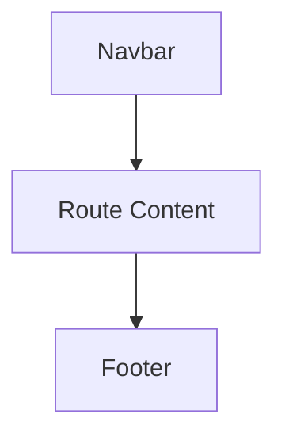
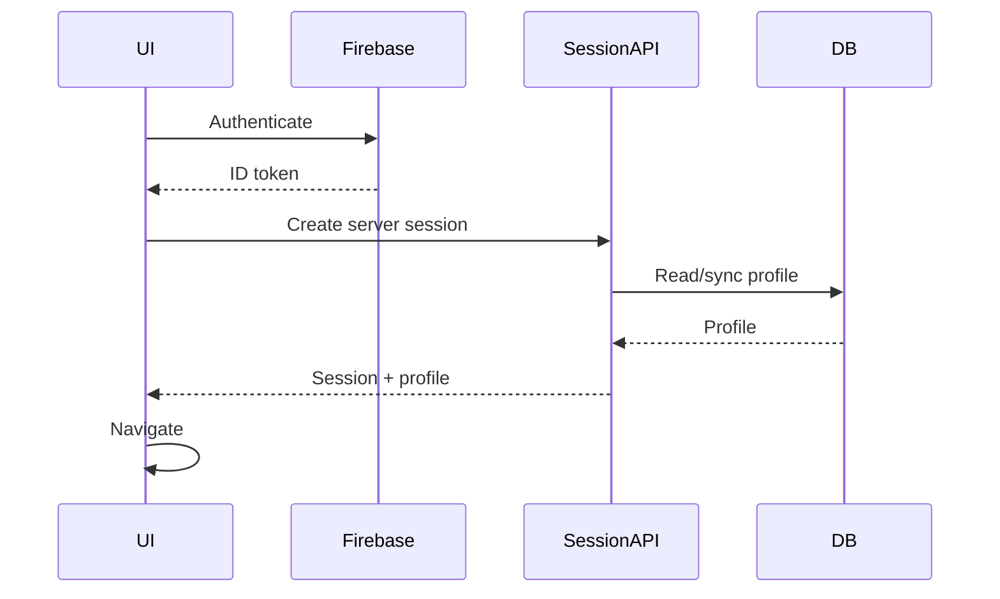
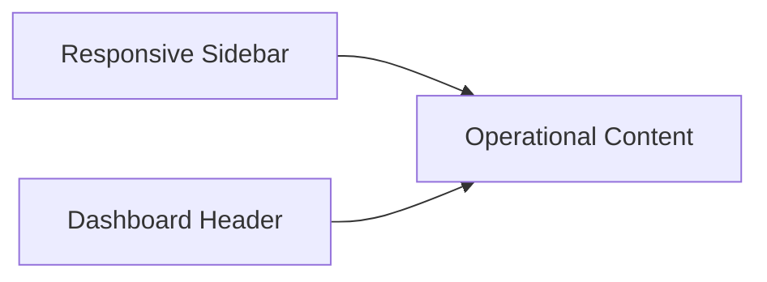

# The Social Scene — Current UI/UX Architecture

This is the current UI/UX reference for the production system. It documents the implemented design direction rather than proposed future screens.

## 1. Design Principles

The Social Scene is intentionally editorial, social and experience-led rather than resembling a conventional ticket marketplace.

Core principles:

- Strong visual hierarchy around event imagery and titles.
- Warm, premium, community-oriented visual language.
- Responsive layouts across desktop and mobile.
- Clear booking CTAs without aggressive marketplace patterns.
- Rounded/floating navigation treatment where implemented.
- Motion is purposeful and should not delay interaction.
- Accessibility and touch usability take priority over decorative effects.

## 2. Visual System

The codebase uses Tailwind CSS v4 and a warm neutral/terracotta visual vocabulary. Individual pages may have contextual tokens, but new UI should reuse existing component conventions instead of introducing unrelated colors.

### Common visual characteristics

- Rounded cards and controls.
- High-contrast primary text.
- Muted secondary text for metadata.
- Large event cover imagery.
- Category/vibe pills.
- Soft borders and translucent/glass surfaces where appropriate.
- Subtle motion through Framer Motion where it adds feedback or storytelling.

## 3. Global Public Layout



The root layout owns global navigation components. Individual pages should not add duplicate global navigation unless there is a deliberate route-specific requirement.

### Navigation behavior

The public Navbar is a shared responsive component. Its floating/rounded behavior is considered a global interaction pattern. Route-specific changes must not regress it on other screens.

When the Navbar changes dimensions during scroll, surrounding content should accommodate that geometry rather than visually jumping underneath it.

## 4. Public Routes

### `/`

Homepage responsibilities:

- Brand introduction and positioning.
- Search/discovery entry point.
- Vibe/category discovery.
- Featured/upcoming experiences.
- Social proof/community storytelling.
- Clear paths into event discovery.

The homepage uses server-side public event data where applicable and should remain fast on repeat navigation through Next.js caching/prefetching.

### `/events`

The events directory is the primary discovery surface.

Expected structure:

```text
Events
├── Search / filters
├── Category / vibe controls
├── Event result grid
└── Empty / loading states
```

Event cards should prioritize image, title, date/time, location, price and availability without overloading the card.

### `/events/[slug]`

The event detail page is the decision surface for booking.

Desktop pattern:

```text
┌───────────────────────────────┬─────────────────────┐
│ Cover / title / description    │ Booking information │
│ Host / venue / schedule       │ Price               │
│ Rules / event information     │ Quantity            │
│                               │ CTA                 │
└───────────────────────────────┴─────────────────────┘
```

Mobile layouts must retain a prominent booking action without creating an obstructive fixed element that blocks content or navigation.

### `/categories` and `/categories/[slug]`

Category pages organize published events around the platform's social/vibe taxonomy. Category pages are public and use cached data.

### `/venues`

Venue discovery provides location context for experiences. Venue information should remain subordinate to the event experience rather than becoming a conventional real-estate-style directory.

### `/become-a-host`

The host application page combines brand storytelling with a structured application form. The form collects enough information for operational review while keeping completion friction reasonable.

Submission states must clearly distinguish:

- Validation errors.
- Duplicate/pending application.
- Successful database submission.
- Notification/email warning when applicable.

## 5. Authentication UX

The login flow supports Firebase-based identity establishment, including phone OTP and available Firebase providers such as Google.

A key implementation rule is that the client must not assume the server session cookie exists immediately after Firebase authentication. The session endpoint establishes the cookie and returns the profile in the same response.



## 6. Checkout UX

Checkout should make the purchase state explicit:

1. Selected event.
2. Quantity.
3. Price calculation.
4. Attendee/contact requirements.
5. Razorpay payment.
6. Verification state.
7. Ticket/pass confirmation.

Never imply a booking is confirmed merely because the Razorpay modal opened. Confirmation follows successful server-side verification/payment processing.

## 7. Ticket / Digital Pass

The digital pass is a functional credential first and a branded artifact second.

Required information should include:

- Event.
- Attendee.
- Date/time.
- Venue.
- Ticket/pass identifier.
- QR payload.
- Barcode where used.

QR and barcode visual elements must retain sufficient contrast and quiet space for reliable scanning.

## 8. Dashboard Design

The dashboard is a separate private application at `admin.thesocialscene.club`.



Primary areas include:

- Overview/analytics.
- Event management.
- Event creation/editing.
- Registrations/attendees.
- Host applications.
- User and RBAC management.
- Payments/orders.
- Scanner/check-in.
- Audit logs.
- Settings and account controls.

## 9. User & RBAC UI

The users area separates identity, role assignment and access status.

Important states:

| Dimension | Examples |
|---|---|
| Role | `SUPER_ADMIN`, `ADMIN`, `HOST`, `CHECKIN_STAFF`, `USER` |
| Access status | `ACTIVE`, `DEACTIVATED`, `SUSPENDED` |
| Host application | `PENDING`, `APPROVED`, `REJECTED` |

A user may have more than one role. UI should therefore render role collections rather than assuming one role per account.

## 10. Event Management UI

The event management interface supports event creation/editing, publishing state, venue/category selection, pricing/capacity, media and host assignment.

Capacity displays must distinguish total capacity, registered/sold quantity and remaining availability. Never derive business-critical inventory from presentation-only values.

## 11. Scanner UI

The scanner must be optimized for rapid repeated use:

- Camera preview should be visually dominant.
- Scan target should have a clear frame.
- Success/error states should be unmistakable.
- Manual ticket-code entry remains available.
- Already-checked-in tickets must not be presented as valid new entries.
- The operator should not need to navigate away for every scan.

## 12. Responsive Rules

### Mobile

- Single-column content where appropriate.
- Touch targets should be comfortably tappable.
- Horizontal filter controls may scroll instead of wrapping into excessive rows.
- Tables should become cards, horizontal scroll regions, or focused mobile views rather than unreadable compressed grids.
- Fixed elements must respect browser safe areas and must not trap scroll.

### Desktop

- Use available width without producing excessively long reading lines.
- Dashboard uses persistent navigation where practical.
- Event discovery uses multi-column grids.
- Detail pages can use two-column layouts with a booking panel.

## 13. Motion & Performance

Animation must not be used as a substitute for loading feedback.

Current performance-oriented UI practices include:

- Immediate route loading UI via `app/loading.tsx`.
- Next.js client navigation.
- Idle prefetching of primary routes.
- Cached public page/data segments.
- Next.js Image optimization for event imagery.

Avoid adding large client-only libraries for simple visual effects.

## 14. Image Strategy

Preferred approach:

1. Store production event imagery using the platform's configured image/storage mechanism.
2. Render remote images through Next.js `<Image>` where supported.
3. Provide meaningful `alt` text.
4. Use responsive `sizes` values so mobile devices do not download desktop-sized assets.
5. Preserve aspect ratio to avoid layout shift.

For documentation visuals, Mermaid diagrams are preferred for architecture. Stable UI screenshots may be placed under `docs/images/` and referenced with relative paths once the screenshots are known to represent the current UI.

## 15. UI Change Checklist

Before merging a UI change:

- Check desktop and mobile.
- Check keyboard focus and interactive states.
- Check loading, empty and error states.
- Check long titles and missing images.
- Check authenticated and unauthenticated states.
- Check Navbar behavior after scroll.
- Check that fixed/sticky elements do not block content.
- Check route navigation speed and prefetch behavior.
- Confirm no duplicate global components were introduced.
