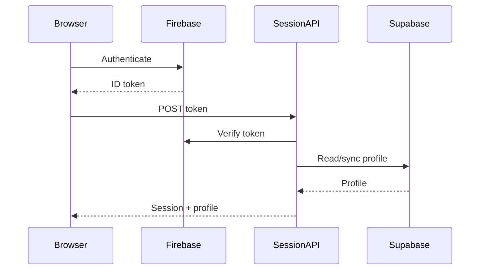
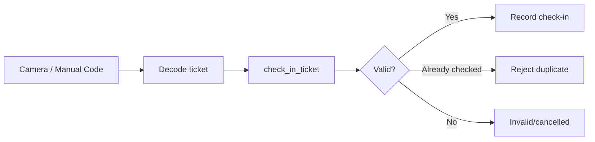

# The Social Scene — Current QA Audit

This document records the current production QA model, verified architecture, and known areas requiring verification. It is not a historical changelog.

## 1. QA Scope

The platform consists of:

- Public event discovery website.
- Firebase-based attendee authentication.
- Event booking and Razorpay payments.
- Digital tickets and QR check-in.
- Host application workflow.
- Private dashboard with RBAC.
- Analytics and GA4 telemetry.
- Supabase PostgreSQL persistence.

## 2. Critical User Journeys

| Journey | Expected result | Priority |
|---|---|---:|
| Browse homepage | Public content renders without authentication | P0 |
| Browse events | Published events load and filter correctly | P0 |
| Open event detail | Published event data loads by slug | P0 |
| Phone authentication | OTP/Firebase identity/session established | P0 |
| Google authentication | Firebase sign-in and server session establish correctly | P1 |
| Complete onboarding | Profile state is persisted | P0 |
| Start checkout | Capacity and booking requirements are validated | P0 |
| Create Razorpay order | Order is created without duplicate/invalid booking | P0 |
| Complete payment | Server verification confirms payment | P0 |
| Webhook replay | Duplicate webhook does not duplicate financial/ticket records | P0 |
| Receive ticket | Digital ticket is created and visible to attendee | P0 |
| Scan ticket | Valid ticket is checked in exactly once | P0 |
| Submit host application | Application is saved to DB and notification is attempted | P0 |
| Review host application | Authorized dashboard user can approve/reject | P1 |
| Manage roles | Authorized admin can assign/revoke supported roles | P0 |
| Audit actions | Sensitive administrative actions are recorded | P1 |
| Analytics | Dashboard metrics and GA4 telemetry are available | P1 |

## 3. Authentication QA

### Firebase/session contract

The public application uses Firebase for identity and a server session cookie for authenticated server requests.

The login sequence must be:



Regression to avoid: Navbar requesting `/api/profile` as part of initial login before the session cookie is established.

### Authentication test matrix

- New phone user.
- Existing phone user.
- Email/Google user.
- User without onboarding completion.
- User with completed onboarding.
- Signed-out user visiting protected route.
- Expired/invalid session.
- Deactivated/suspended dashboard account.

## 4. Booking & Payment QA

Payment state must be derived from server-verified state, not from client UI callbacks alone.

Test:

1. Valid published event with available capacity.
2. Event at capacity.
3. Concurrent checkout attempts.
4. Razorpay order creation failure.
5. Payment success followed by verification.
6. Verification failure.
7. Duplicate webhook delivery.
8. Payment/order mismatch.
9. Ticket generation failure after payment.
10. Reconciliation of order, payment, registration and ticket records.

## 5. Host Application QA

The endpoint `/api/host-applications` should:

- Validate submitted fields.
- Reject invalid/duplicate pending submissions according to business rules.
- Persist the application in `host_applications`.
- Send notification through Resend to the configured administration mailbox.
- Await the Resend API call.
- Log the Resend error/ID.
- Return a warning rather than pretending the email succeeded when persistence succeeded but email failed.

Current configured notification destination in application code: `support@thesocialscene.club`.

## 6. RBAC QA

Authorization is a server-side concern. Hiding a button is not sufficient.

Test each sensitive operation with:

- Unauthenticated user.
- `USER`.
- `HOST`.
- `CHECKIN_STAFF`.
- `ADMIN`.
- `SUPER_ADMIN`.
- Multiple concurrent roles.
- Deactivated account.
- Suspended account.

Confirm both UI visibility and API/server authorization.

## 7. Scanner QA



Test poor lighting, repeated scans, invalid codes, cancelled tickets, already checked-in tickets, manual code entry, camera permission denial and mobile browsers.

## 8. Performance QA

The current performance strategy includes cached public data, public HTTP caching, client navigation prefetching, router segment stale times, optimized images and database indexes.

Performance tests should measure separately:

- First page load.
- Client-side navigation to prefetched route.
- Client-side navigation to uncached route.
- Server-rendered public route.
- API response time.
- Third-party provider latency.

The sub-200 ms target should be interpreted as a perceived navigation target for cached/prefetched routes, not a guarantee for every uncached request or third-party transaction.

## 9. Analytics QA

Verify:

- GA4 measurement ID is configured only in client-safe variables.
- Page views are emitted once per navigation.
- Important event interactions use stable event names.
- Dashboard analytics APIs authenticate correctly.
- Provider failures do not break the dashboard UI.

A previously observed production issue was `500 Unable to authenticate with Google Analytics` on the realtime analytics endpoint. This should be treated as an integration-health issue rather than a database performance issue.

## 10. Responsive QA

Minimum browser/device matrix:

- Desktop Chrome/Edge.
- Mobile Chrome Android.
- Safari iOS.
- Narrow viewport around 320–375 px.
- Tablet width.

Pay particular attention to the global floating/rounded Navbar, sticky booking controls, scanner camera permissions, modal scroll locking and tables.

## 11. Data Integrity Checks

For production diagnosis, compare related records rather than trusting UI counts alone:

```text
registrations
   └── orders
        └── payments
   └── tickets
        └── checkins
```

Financial and inventory numbers should be derived from authoritative database state.

## 12. Release Gate

A production release should not be considered complete until:

- `next build` passes for affected applications.
- TypeScript compilation passes.
- Authentication smoke tests pass.
- Booking/payment smoke test passes in the intended environment.
- Host application persistence/email behavior is verified.
- Dashboard authorization is verified.
- Scanner smoke test passes.
- No critical console/network errors remain on primary flows.
- Documentation is updated when architecture or user-visible behavior changes.
