# The Social Scene — Event Discovery & Management Platform

[](https://nextjs.org/)
[](https://www.typescriptlang.org/)
[](https://supabase.com/)
[](https://firebase.google.com/)
[](https://razorpay.com/)
[](https://tailwindcss.com/)

> **Official Brand Motto:** *Come Solo. Leave With Stories.*  
> **Production Domains:**  
> - Public Discovery Website: `https://thesocialscene.club`  
> - Admin & Host Operations Dashboard: `https://admin.thesocialscene.club`

---

## 📁 Repository Structure (Monorepo)

```text
.
├── frontend/                     # Public Audience Discovery Site (thesocialscene.club)
├── dashboard/                    # Operations & Host Dashboard (admin.thesocialscene.club)
└── backend/                      # Core Relational Database & Shared Business Logic
```

---

## 🚀 Quick Start (Local Development)

### 1. Install Dependencies

```bash
cd frontend && npm install
cd ../dashboard && npm install
```

### 2. Environment Setup

Copy the application-specific templates:

```bash
copy frontend\.env.example frontend\.env.local
copy dashboard\.env.example dashboard\.env.local
```

Then replace every placeholder with the corresponding value from your local development credentials. **Never commit `.env.local` files or real secrets.**

Server-only credentials include Firebase Admin credentials, the Supabase service-role key, 2Factor API key, Razorpay secret/webhook secret, and Resend API key. These must never be exposed through `NEXT_PUBLIC_*` variables.

### 3. Run Local Dev Servers

```bash
# Terminal 1 — Public Website
cd frontend && npm run dev
# http://localhost:3000

# Terminal 2 — Admin Dashboard
cd dashboard && npm run dev -- -p 3001
# http://localhost:3001
```

---

## 🗄️ Database Migrations (Supabase PostgreSQL)

Apply the migrations in `backend/supabase/migrations/` in sequence (00001 to 00017):

1. `00001_initial_schema.sql` — Initial schema definitions.
2. `00002_functions_triggers.sql` — Capacity lock and trigger functions.
3. `00003_auth_profile_and_rls.sql` — Profiles & RLS policies.
4. `00004_public_event_access.sql` — Public experience visibility rules.
5. `00007_auth_hardening_and_dashboard_rbac.sql` — Dashboard access control & RBAC roles.
6. `00008_firebase_phone_auth.sql` — Firebase phone auth integration bridge.
7. `00009_razorpay_and_checkin.sql` — Razorpay payment orders & check-in verification functions.
8. `00010_payment_webhook_idempotency.sql` — Webhook idempotency tracking table.
9. `00011_security_harden_rpc_execution.sql` — RPC security function hardening.
10. `00012_revoke_public_rpc_execute.sql` — Revoke public execute access on administrative RPC functions.
11. `00014_host_applications_and_dashboard_access.sql` — Host application submission & approval workflow.
12. `00015_unify_dashboard_auth_with_existing_profiles.sql` — Unified dashboard authentication with existing profile structure.
13. `00016_dashboard_access_status_rbac.sql` — Dashboard access status controls & user management.
14. `00017_multi_role_rbac.sql` — Multi-role RBAC authorization framework & database functions.

---

## 📊 Database ER Diagram

Below is the complete Entity-Relationship diagram representing the 27 database schema tables across profiles, RBAC, events, registrations, orders, tickets, check-ins, and auditing. For additional background details, see [`docs/database-er-diagram.md`](file:///d:/Freelance/Project-12%20%28TheSocialScene/docs/database-er-diagram.md).

```mermaid
erDiagram
    profiles {
        uuid id PK
        uuid auth_user_id
        text full_name
        text phone
        text email
        text status
        boolean phone_verified
        boolean email_verified
    }
    roles {
        uuid id PK
        text name
        text description
        boolean is_system
    }
    permissions {
        uuid id PK
        text key
        text description
        text category
    }
    user_roles {
        uuid id PK
        uuid user_id FK
        uuid role_id FK
    }
    role_permissions {
        uuid id PK
        uuid role_id FK
        uuid permission_id FK
    }
    event_categories {
        uuid id PK
        text name
        text slug
    }
    venues {
        uuid id PK
        text name
        text slug
        integer capacity
    }
    events {
        uuid id PK
        text title
        text slug
        uuid category_id FK
        uuid host_id FK
        uuid venue_id FK
        timestamp start_at
        timestamp end_at
        integer capacity
        numeric price
        text status
    }
    event_images {
        uuid id PK
        uuid event_id FK
        text image_url
    }
    event_hosts {
        uuid id PK
        uuid event_id FK
        uuid host_profile_id FK
        text role
    }
    event_schedules {
        uuid id PK
        uuid event_id FK
        text title
        timestamp start_time
        timestamp end_time
    }
    registrations {
        uuid id PK
        text registration_number
        uuid event_id FK
        uuid user_id FK
        text status
        numeric total_amount
    }
    registration_items {
        uuid id PK
        uuid registration_id FK
        text ticket_type
        numeric unit_price
        integer quantity
    }
    tickets {
        uuid id PK
        text ticket_code
        uuid registration_id FK
        uuid event_id FK
        uuid user_id FK
        text status
    }
    checkins {
        uuid id PK
        uuid ticket_id FK
        uuid event_id FK
        uuid user_id FK
        uuid checked_in_by FK
        timestamp checked_in_at
    }
    waitlists {
        uuid id PK
        uuid event_id FK
        uuid user_id FK
        integer position
        text status
    }
    orders {
        uuid id PK
        uuid registration_id FK
        uuid user_id FK
        numeric amount
        text status
        text razorpay_order_id
    }
    payments {
        uuid id PK
        uuid order_id FK
        text provider
        text provider_payment_id
        numeric amount
        text status
    }
    refunds {
        uuid id PK
        uuid payment_id FK
        numeric amount
        text status
    }
    coupons {
        uuid id PK
        text code
        text discount_type
        numeric discount_value
    }
    coupon_redemptions {
        uuid id PK
        uuid coupon_id FK
        uuid user_id FK
        uuid registration_id FK
    }
    reviews {
        uuid id PK
        uuid event_id FK
        uuid user_id FK
        integer rating
        text status
    }
    notifications {
        uuid id PK
        uuid user_id FK
        text type
        text title
    }
    audit_logs {
        uuid id PK
        uuid actor_user_id FK
        text action
        text entity_type
    }
    attendance_events {
        uuid id PK
        uuid ticket_id FK
        uuid event_id FK
        uuid user_id FK
        uuid scanned_by FK
        text type
    }
    payment_webhook_events {
        uuid id PK
        text razorpay_event_id
        text event_type
        text status
    }
    host_applications {
        uuid id PK
        uuid profile_id FK
        uuid reviewed_by FK
        text status
    }

    profiles ||--o{ user_roles : "has"
    roles ||--o{ user_roles : "assigned_to"
    roles ||--o{ role_permissions : "has"
    permissions ||--o{ role_permissions : "assigned_to"

    profiles ||--o{ host_applications : "applicant"
    profiles ||--o{ host_applications : "reviewer"

    event_categories ||--o{ events : "categorizes"
    venues ||--o{ events : "hosts_at"
    profiles ||--o{ events : "primary_host"
    profiles ||--o{ event_hosts : "co_host"
    events ||--o{ event_hosts : "co_hosts"
    events ||--o{ event_images : "gallery"
    events ||--o{ event_schedules : "schedule"

    events ||--o{ registrations : "registers_for"
    profiles ||--o{ registrations : "registers"
    registrations ||--o{ registration_items : "items"

    registrations ||--|| orders : "generates"
    profiles ||--o{ orders : "places"
    orders ||--o{ payments : "paid_via"
    payments ||--o{ refunds : "refunded_via"

    registrations ||--o{ tickets : "issues"
    events ||--o{ tickets : "valid_for"
    profiles ||--o{ tickets : "owns"

    tickets ||--o| checkins : "scanned"
    events ||--o{ checkins : "venue_checkin"
    profiles ||--o{ checkins : "attendee"
    profiles ||--o{ checkins : "scanner"

    tickets ||--o{ attendance_events : "logs"
    events ||--o{ attendance_events : "logs"
    profiles ||--o{ attendance_events : "attendee"
    profiles ||--o{ attendance_events : "scanner"

    events ||--o{ waitlists : "queue"
    profiles ||--o{ waitlists : "waits"

    coupons ||--o{ coupon_redemptions : "redeemed"
    profiles ||--o{ coupon_redemptions : "redeemed_by"
    registrations ||--o{ coupon_redemptions : "applied_to"

    events ||--o{ reviews : "reviewed"
    profiles ||--o{ reviews : "author"

    profiles ||--o{ notifications : "notified"
    profiles ||--o{ audit_logs : "actor"
```



---

## ✨ Features Implemented

- **GoFlow Public Discovery:** Live ticker marquee, retro emblem hero, interactive vibe pills, attendee avatar stacks.
- **Firebase & 2Factor Phone Auth:** SMS OTP verification with automatic profile creation and session cookies.
- **Optional Email Verification:** Firebase handles email verification while the verified email is synchronized to the user's Supabase profile.
- **Razorpay Payments & Tickets:** Order generation, payment verification, webhook handlers, and digital pass generation.
- **Physical Ticket Stub View:** Barcode, QR code renderer, and seat metadata.
- **Admin Dashboard & Scanner:** Recharts telemetry, event wizard, camera check-in scanner, attendee exports.
- **Google Analytics Integration:** Built-in telemetry.

---

## 🔐 Security Rules

- Never commit `.env.local`, service-account JSON files, private keys, API secrets, or webhook secrets.
- Keep Firebase Admin, Supabase service-role, 2Factor, Razorpay Secret, Razorpay webhook, and Resend credentials server-side.
- Use test-mode Razorpay credentials for local payment testing.
- If a secret is accidentally committed, rotate/revoke it immediately and remove it from the repository.
