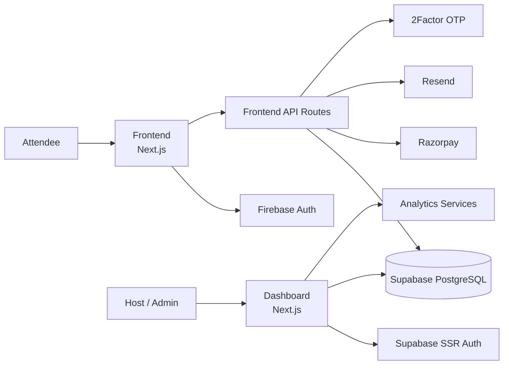
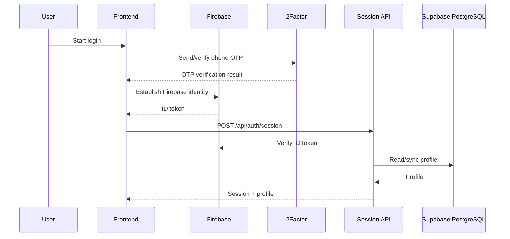
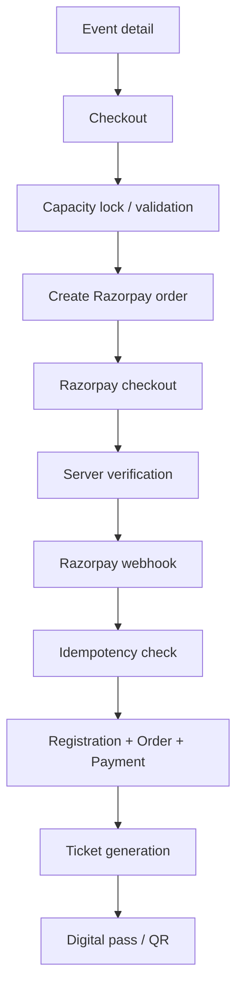

# The Social Scene

> **Come Solo. Leave With Stories.**

The Social Scene is a production event-discovery, ticketing, host-operations, and event check-in platform. The repository is a decoupled monorepo containing the public website, private operations dashboard, shared database migrations/domain services, and technical documentation.

## Current Production System

| Area | Current implementation |
|---|---|
| Public website | Next.js 16.3.2 + React 19.2.8 |
| Operations dashboard | Next.js 16.3.2 + React 19.2.8 |
| Database | PostgreSQL managed by Supabase |
| Public authentication | Firebase Authentication; phone OTP is verified through 2Factor |
| Dashboard authentication | Supabase SSR authentication |
| Payments | Razorpay |
| Transactional email | Resend |
| Analytics | Google Analytics / GA4 integration plus dashboard analytics |
| QR check-in | `html5-qrcode` + database check-in RPC |
| Styling | Tailwind CSS v4 |
| Hosting | Vercel |
| Public production domain | `https://www.thesocialscene.club` |
| Dashboard production domain | `https://admin.thesocialscene.club` |

**Important:** Supabase PostgreSQL is the current system of record. The repository does not currently use Neon as its production database.

## Repository Architecture



### Repository layout

```text
TheSocialScene/
├── frontend/       # Public attendee website
├── dashboard/      # Private operations, host and admin portal
├── backend/        # PostgreSQL migrations, domain services and DB types
├── docs/           # Architecture, analytics, performance and database docs
├── DESIGN.md       # UI/UX reference
├── QA_AUDIT.md     # Current QA and known-risk record
└── updates.md      # Product/architecture status and deferred work
```

## Core Product Flows

### 1. Authentication



The login flow deliberately returns the profile from session establishment so the Navbar does not immediately race `/api/profile` while the session cookie is being created.

Google sign-in is also available through Firebase. Users authenticated by email/Google may need to add and verify a mobile number before ticket booking when the booking flow requires a verified contact number.

### 2. Host application

`/become-a-host` submits to `/api/host-applications`.

1. Request is validated.
2. Duplicate pending/host checks are performed.
3. Application is inserted into `host_applications`.
4. A notification is sent through Resend to `support@thesocialscene.club`.
5. The email is **awaited** and Resend errors are surfaced/logged instead of being silently ignored.
6. The submitted address is used as `replyTo` for administrative follow-up.

The database record is therefore the durable source of truth; email is the notification channel.

### 3. Ticket purchase



Capacity protection and payment webhook idempotency are implemented at the database/application boundary to reduce overselling and duplicate processing.

### 4. Check-in

Dashboard staff can scan a ticket QR code using the device camera or enter a ticket code manually. The database check-in procedure validates the ticket and prevents duplicate check-in.

### 5. RBAC

The platform supports multiple roles per user. Current role concepts include `SUPER_ADMIN`, `ADMIN`, `HOST`, `CHECKIN_STAFF`, and `USER`, with permission mapping stored in the database. Account access status is separately controlled.

## Current Database Domains

The PostgreSQL schema covers:

- Profiles and identity mapping
- Roles, permissions and user-role assignments
- Host applications and review state
- Event categories, events, venues and event-host relationships
- Registrations and registration items
- Orders and payments
- Tickets and ticket ownership
- Check-ins and attendance events
- Audit logs
- Payment webhook idempotency records
- Event tags/wishlist-related data

The canonical schema and migration history live under `backend/supabase/migrations/`.

## Current Performance Architecture

The public application currently uses several layers of performance optimization:

- Next.js App Router client navigation and production prefetching.
- `experimental.staleTimes` for client router segment reuse.
- `router.prefetch()` for primary routes during idle time.
- Cached public event/category queries using `unstable_cache`.
- Public HTTP caching for suitable public pages.
- Next.js `<Image>` for event imagery.
- `optimizePackageImports` for `lucide-react`.
- In-memory deduplication/caching for selected profile requests.
- Database indexes for search/event lookup paths.

The target is sub-200 ms perceived navigation where cached/prefetched content is available. Actual first-load latency still depends on network, Vercel execution, uncached server work, third-party services and device conditions.

## Database Migration Source of Truth

All database migrations remain in the repository under `backend/supabase/migrations/`. Existing migration files should be treated as historical schema evolution and should not be rewritten merely to make the history look cleaner.

A separate `docs/migration-suggestion.md` exists as a **future planning document only**. It does not describe the current production architecture.

## Local Development

### Frontend

```bash
cd frontend
npm install
npm run dev
```

Default development URL: `http://localhost:3000`.

### Dashboard

```bash
cd dashboard
npm install
npm run dev -- -p 3001
```

Default development URL: `http://localhost:3001`.

### Backend / database

The `backend/` package contains database migrations, domain services and generated/shared database types. Database credentials and service keys must remain in environment configuration and must never be committed.

## Production Deployment

The frontend and dashboard are separate Next.js applications deployed on Vercel. The frontend is configured for the Mumbai (`bom1`) region with a failover region configured in `frontend/vercel.json`.

Before considering a deployment complete, verify:

1. Production build succeeds.
2. Authentication works.
3. Public event discovery works.
4. Checkout/order creation works.
5. Razorpay verification/webhook processing works.
6. Ticket generation works.
7. Dashboard RBAC works.
8. QR check-in works.
9. Host application persistence and Resend notification work.
10. Analytics endpoints and GA4 telemetry are healthy.

## Security Rules

- Never expose Supabase service-role credentials to the browser.
- Never expose Firebase Admin credentials client-side.
- Validate API input server-side with the project's validation layer.
- Keep payment signature verification server-side.
- Keep administrative APIs behind authentication and permission checks.
- Treat database RLS and RPC permissions as part of the security boundary.
- Do not commit `.env.local` or production secrets.

## Documentation Map

| Document | Purpose |
|---|---|
| `DESIGN.md` | Current visual/layout/component architecture |
| `QA_AUDIT.md` | QA coverage, known defects and verification priorities |
| `updates.md` | Current product/architecture status and deferred work |
| `backend/README.md` | Database, migrations and backend domain services |
| `frontend/README.md` | Public website implementation |
| `dashboard/README.md` | Operations/admin implementation |
| `docs/database-er-diagram.md` | Detailed relational model |
| `docs/admin-management.md` | Current dashboard user/RBAC management |
| `docs/analytics.md` | Current analytics architecture |
| `docs/ga4-setup.md` | Current GA4 integration and configuration |
| `docs/performance-optimization.md` | Current navigation/server/database performance work |
| `docs/migration-suggestion.md` | Future Supabase-to-Neon planning; not current architecture |

## Documentation Visuals

Where GitHub rendering supports it, this repository uses Mermaid diagrams for architecture, sequences and database relationships. These are preferred over static screenshots for diagrams because they remain editable with the codebase.

For UI documentation, screenshots can be added under `docs/images/` and referenced with relative Markdown paths when stable screenshots are available. No screenshot should be presented as current if it does not match the deployed UI.
