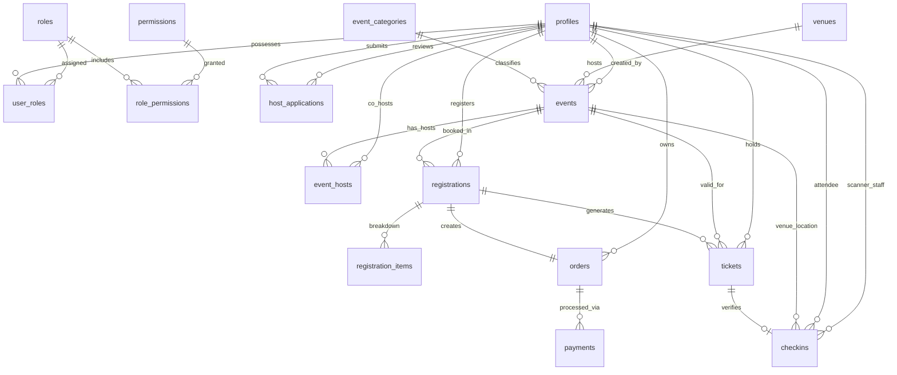

# The Social Scene — Event Discovery & Management Platform

[](https://nextjs.org/)
[](https://react.dev/)
[](https://www.typescriptlang.org/)
[](https://supabase.com/)
[](https://firebase.google.com/)
[](https://razorpay.com/)
[](https://tailwindcss.com/)

> **Official Brand Motto:** *Come Solo. Leave With Stories.*  
> **Production Deployment URLs:**  
> - **Public Discovery Portal:** `https://thesocialscene.club`  
> - **Operations & Host Dashboard:** `https://admin.thesocialscene.club`

---

## 📁 Monorepo Structure

```text
.
├── frontend/                     # Public Audience Discovery Application (thesocialscene.club)
│   ├── app/                      # Next.js App Router (Public routes, Auth, Account, Checkout)
│   ├── components/               # GoFlow UI components, profile editor, GA4 telemetry
│   └── lib/                      # Firebase Client/Admin SDK, Supabase client/ssr, helpers
│
├── dashboard/                    # Operations & Host Management Portal (admin.thesocialscene.club)
│   ├── app/                      # Next.js App Router (Analytics, Scanner, Users, Roles, Events)
│   ├── components/               # AccessActionMenu, DashboardRouteGuard, Layout headers
│   └── lib/                      # RBAC permission guards, user provisioning, Supabase admin
│
├── backend/                      # System of Record & Shared Database Architecture
│   ├── services/                 # Analytics, Audit, Checkin, Event, Payment, Ticket services
│   ├── supabase/migrations/      # 17 SQL migrations (Initial schema -> Multi-Role RBAC)
│   └── types/                    # Auto-generated Supabase schema definitions & RBAC types
│
└── docs/                         # Architecture, Admin Management & Database ER Specifications
```

---

## 🛠️ Technology Stack & Libraries

| Domain | Technology / Library | Purpose |
| :--- | :--- | :--- |
| **Frontend Framework** | **Next.js 16.3.2 (App Router)** | Full-stack SSR, Server Components, API Routes |
| **UI Library** | **React 19.2.8** | Component rendering & state management |
| **Styling** | **Tailwind CSS v4 & PostCSS** | Modern utility-first design system |
| **Animations** | **Framer Motion 13.1** | Micro-interactions, page transitions, GoFlow motion |
| **Icons & Visuals** | **Lucide React 1.33** | Scalable UI iconography |
| **Data Analytics** | **Recharts 3.10** | Telemetry charts, registration trends & financial KPIs |
| **QR Scanner** | **html5-qrcode 2.3** | Live camera video feed ticket scanner in Dashboard |
| **Database** | **Supabase PostgreSQL** | Relational database, RLS policies & RPC functions |
| **Public Auth** | **Firebase Auth & 2Factor API** | Mobile Phone SMS OTP & Firebase Session Cookies |
| **Dashboard Auth** | **Supabase SSR Auth** | Role-protected admin sessions & cookie management |
| **Payments** | **Razorpay Payment Gateway** | Order creation, signature verification & webhooks |
| **Analytics** | **Google Analytics 4** | Telemetry tracking (`G-V3MYL05JWV`) |

---

## 🚀 Key Features Implemented

### 🌐 Public Experience (`frontend`)
- **GoFlow Discovery UI:** Marquee tickers, vibe filter pills, hero search, attendee avatar stacks, and quote walls.
- **Firebase & 2Factor Phone OTP:** SMS OTP verification with automatic profile creation and session cookies.
- **Razorpay Checkout:** Secure payment modal, server-side signature verification, and automated pass issuance.
- **Digital Ticket Pass:** Tear-notch physical ticket stub aesthetics, barcode visualization, and QR code renderer.
- **Host Application Portal:** Interactive `/become-a-host` form with social links and event proposal submissions.

### 🛡️ Dashboard & Operations (`dashboard`)
- **Multi-Role Access Control (RBAC):** Server-enforced multi-role permissions (`SUPER_ADMIN`, `ADMIN`, `HOST`, `CHECKIN_STAFF`, `USER`) supporting concurrent roles.
- **Route Guarding:** `DashboardRouteGuard` & `AccessActionMenu` for granular role toggling and user provisioning.
- **Event Creator Wizard:** 9-section multi-step administrative experience configuration.
- **Camera Ticket Scanner:** Live camera feed ticket verification with manual code fallback and double check-in prevention.
- **Host Applications Management:** Review, approve, or reject host applications with automated credential delivery.

---

## 🗄️ Database Schema & Migrations

All migrations reside in `backend/supabase/migrations/` and must be applied in sequence:

1. `00001_initial_schema.sql` — Profiles, Events, Registrations, Orders, Payments, Tickets.
2. `00002_functions_triggers.sql` — Capacity lock and trigger functions.
3. `00003_auth_profile_and_rls.sql` — Profiles & RLS security policies.
4. `00004_public_event_access.sql` — Public event visibility rules.
5. `00007_auth_hardening_and_dashboard_rbac.sql` — Dashboard access control & RBAC roles.
6. `00008_firebase_phone_auth.sql` — Firebase phone auth integration bridge.
7. `00009_razorpay_and_checkin.sql` — Razorpay payment orders & check-in verification functions.
8. `00010_payment_webhook_idempotency.sql` — Webhook idempotency tracking table.
9. `00011_security_harden_rpc_execution.sql` — RPC security function hardening.
10. `00012_revoke_public_rpc_execute.sql` — Revoke public execute access on administrative RPC functions.
11. `00014_host_applications_and_dashboard_access.sql` — Host application submission & approval workflow.
12. `00015_unify_dashboard_auth_with_existing_profiles.sql` — Unified dashboard authentication with profiles.
13. `00016_dashboard_access_status_rbac.sql` — Dashboard access status controls & user management.
14. `00017_multi_role_rbac.sql` — Multi-role RBAC authorization framework & database functions.

---

## 📊 Database Entity-Relationship (ER) Diagram

### High-Level Relationship Overview



> 📖 **Detailed Domain Diagrams:** For field-level ER specifications split across Identity/RBAC, Events, Ticketing, and Payments, see [`docs/database-er-diagram.md`](file:///d:/Freelance/Project-12%20%28TheSocialScene/docs/database-er-diagram.md).

---

## ⚡ Quick Start (Local Development)

### 1. Install Dependencies

```bash
cd frontend && npm install
cd ../dashboard && npm install
```

### 2. Environment Setup

Copy `.env.example` templates to `.env.local` in both `frontend` and `dashboard`:

```bash
copy frontend\.env.example frontend\.env.local
copy dashboard\.env.example dashboard\.env.local
```

### 3. Run Dev Servers

```bash
# Terminal 1 — Public Website (http://localhost:3000)
cd frontend && npm run dev

# Terminal 2 — Admin Dashboard (http://localhost:3001)
cd dashboard && npm run dev -- -p 3001
```
