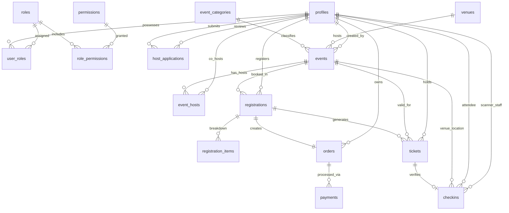

# 🌟 The Social Scene — Event Discovery & Management Monorepo

[](https://nextjs.org/)
[](https://react.dev/)
[](https://www.typescriptlang.org/)
[](https://supabase.com/)
[](https://firebase.google.com/)
[](https://razorpay.com/)
[](https://tailwindcss.com/)

> **Official Brand Motto:** *Come Solo. Leave With Stories.*  
> **Production URLs:**  
> - **Public Discovery Website:** `https://thesocialscene.club`  
> - **Operations & Host Dashboard:** `https://admin.thesocialscene.club`

---

## 📖 Table of Contents
1. [Project Overview](#-project-overview)
2. [Monorepo Architecture](#-monorepo-architecture)
3. [End-to-End Core Workflows](#-end-to-end-core-workflows)
4. [Technology Stack](#-technology-stack)
5. [Database Migrations Catalog](#-database-migrations-catalog)
6. [Database ER Diagram Overview](#-database-er-diagram-overview)
7. [Detailed Folder & Code Map](#-detailed-folder--code-map)
8. [Environment Variable Configuration](#-environment-variable-configuration)
9. [Developer Quick Start Guide](#-developer-quick-start-guide)
10. [Security & Production Guidelines](#-security--production-guidelines)

---

## 🧐 Project Overview

**The Social Scene** is a full-stack, production-grade event discovery and operations platform designed to bring people together through curated social experiences.

### Key Objectives
- **For Attendees:** Discover local social events by vibe/category, sign in via mobile phone OTP, securely purchase tickets using Razorpay, and receive instant digital passes with scannable QR payloads and barcodes.
- **For Event Hosts & Community Creators:** Submit host application proposals (`/become-a-host`), manage event schedules, configure venue details, track attendee rosters, and view real-time revenue analytics.
- **For Platform Administrators & Check-In Staff:** Enforce multi-role Role-Based Access Control (RBAC), provision user access levels, scan physical/digital tickets via live camera feed, and maintain audit logs of all platform actions.

---

## 🏗️ Monorepo Architecture

The repository is structured as a decoupled monorepo containing two Next.js 16 applications sharing a centralized PostgreSQL relational database managed via Supabase.

```text
TheSocialScene (Monorepo Root)
├── frontend/                 # Public-facing Audience Web Application
├── dashboard/                # Operations, Host & Admin Portal
├── backend/                  # Relational Schema, Migrations & Domain Services
└── docs/                     # Architectural Documentation & ER Diagrams
```

### Why Decouple Frontend & Dashboard?
1. **Security Isolation:** Administrative endpoints and check-in scanner capabilities are completely separated from public discovery routes, reducing the attack surface.
2. **Domain Separation:** Allows hosting the public site at `thesocialscene.club` and the administration app at `admin.thesocialscene.club`.
3. **Optimized Asset Bundles:** Audience web pages load zero administrative scanner scripts or charting libraries, resulting in faster initial page loads and superior SEO performance.

---

## 🔄 End-to-End Core Workflows

### 1. 📱 Authentication & User Onboarding Flow
```text
[User Enters Mobile Phone Number]
          │
          ▼
[Frontend API invokes 2Factor SMS OTP Provider]
          │
          ▼
[User Submits 6-Digit OTP]
          │
          ▼
[Firebase Auth Verifies Token & Creates Session Cookie]
          │
          ▼
[API Synchronizes Auth ID with Supabase 'profiles' Table]
```
- **Public App:** Users log in using mobile phone numbers verified via **2Factor SMS OTP**. Firebase handles identity management, while user profiles (name, email, phone, avatar) are stored in the Supabase PostgreSQL `profiles` table.
- **Dashboard App:** Administrators and hosts log in through Supabase SSR Auth with email/password credentials or pre-provisioned invitations.

---

### 2. 💳 Ticket Checkout & Payment Processing Flow
```text
[User Clicks 'Book Ticket']
          │
          ▼
[Database executes 'lock_event_capacity' RPC]
          │
          ▼
[Backend creates Razorpay Payment Order]
          │
          ▼
[User Completes Payment in Razorpay Gateway Modal]
          │
          ▼
[Razorpay Webhook verifies HMAC Signature -> 'payment_webhook_events']
          │
          ▼
[System creates 'registrations', 'orders', 'payments', and 'tickets']
```
- **Race Condition Prevention:** When a user initiates checkout, the PostgreSQL function `lock_event_capacity` temporarily holds event capacity to prevent overselling during high-demand events.
- **Idempotent Webhooks:** Razorpay payment webhooks are recorded in `payment_webhook_events`. The system ensures duplicate webhook payloads are ignored, preventing double ticket generation.
- **Pass Issuance:** Once payment is captured, digital tickets with unique QR code payloads and barcodes are automatically assigned to the user's wallet.

---

### 3. 📷 Event Check-In & Scanner Flow
```text
[Staff Opens Scanner Page in Dashboard]
          │
          ▼
[html5-qrcode activates Device Camera Feed]
          │
          ▼
[Scanner decodes Ticket QR Payload]
          │
          ▼
[API calls Supabase 'check_in_ticket' RPC Function]
          │
          ▼
[Database validates Ticket Status & prevents Double Check-In]
          │
          ▼
[Check-In Recorded in 'checkins' & 'attendance_events' Tables]
```
- **Operational Scanner:** Check-in staff view a live video feed on mobile or desktop devices.
- **Atomic Validation:** The database RPC procedure `check_in_ticket` verifies ticket ownership, checks if the ticket has already been used, marks the ticket as `CHECKED_IN`, and logs an entry in `checkins` and `attendance_events`.

---

### 4. 🛡️ Multi-Role RBAC & Access Control Flow
```text
[Super Admin manages User Roles in Dashboard]
          │
          ▼
[API updates 'user_roles' table via migration 00017]
          │
          ▼
[DashboardRouteGuard checks 'has_permission' RPC]
          │
          ▼
[UI dynamically enables/disables Administrative Actions]
```
- **Concurrent Roles:** Users can hold multiple roles simultaneously (e.g. `HOST` + `ADMIN`).
- **Role Hierarchy:**
  - `SUPER_ADMIN`: Full platform control, role management, access status toggles.
  - `ADMIN`: Manages events, host applications, analytics, and registrations.
  - `HOST`: Creates and manages owned events and views attendee lists.
  - `CHECKIN_STAFF`: Accesses ticket camera scanner and attendance logs.
  - `USER`: Audience member who can book tickets and view passes.

---

## 🛠️ Technology Stack

### Monorepo Components & Dependencies

```text
               ┌─────────────────────────────────────────┐
               │          The Social Scene System         │
               └────────────────────┬────────────────────┘
                                    │
         ┌──────────────────────────┼──────────────────────────┐
         ▼                          ▼                          ▼
┌──────────────────┐       ┌──────────────────┐       ┌──────────────────┐
│  frontend (Web)  │       │ dashboard (Admin)│       │ backend (Database│
├──────────────────┤       ├──────────────────┤       ├──────────────────┤
│ Next.js 16.3.2   │       │ Next.js 16.3.2   │       │ PostgreSQL 15    │
│ React 19.2.8     │       │ React 19.2.8     │       │ Supabase RLS     │
│ Tailwind CSS v4  │       │ Tailwind CSS v4  │       │ RPC Procedures   │
│ Framer Motion 13 │       │ Recharts 3.10    │       │ 17 SQL Migrations│
│ Firebase Auth    │       │ html5-qrcode 2.3 │       │ Shared Services  │
│ Razorpay SDK     │       │ Supabase SSR     │       │ Type Definitions │
└──────────────────┘       └──────────────────┘       └──────────────────┘
```

| Framework / Tool | Version | Application | Description |
| :--- | :--- | :--- | :--- |
| **Next.js** | `16.3.2` | Frontend & Dashboard | App Router, Server Components, API Routes |
| **React** | `19.2.8` | Frontend & Dashboard | Core UI rendering library |
| **TypeScript** | `5.0+` | All Packages | End-to-end type safety |
| **Tailwind CSS** | `4.0+` | Frontend & Dashboard | Utility-first styling engine |
| **Supabase Client / SSR** | `2.112.3` / `0.12.4` | All Packages | PostgreSQL connection & session cookies |
| **Firebase Admin & Client**| `13.5.0` / `12.0.0` | Frontend & Dashboard | Phone OTP & Identity verification |
| **Framer Motion** | `13.1.1` | Frontend | Dynamic UI animations & GoFlow motion |
| **Recharts** | `3.10.1` | Dashboard | Administrative telemetry charts & KPI trends |
| **html5-qrcode** | `2.3.8` | Dashboard | Camera feed QR ticket scanner |
| **Lucide React** | `1.33.0` | Frontend & Dashboard | Scalable icon library |
| **Zod** | `4.4.3` | All Packages | Request validation schemas |

---

## 🗄️ Database Migrations Catalog

Database migrations reside in `backend/supabase/migrations/` and define the relational structure:

1. `00001_initial_schema.sql` — Core tables: `profiles`, `events`, `registrations`, `orders`, `payments`, `tickets`.
2. `00002_functions_triggers.sql` — Capacity lock procedures and automatic `updated_at` trigger functions.
3. `00003_auth_profile_and_rls.sql` — Supabase authentication binding and Row-Level Security (RLS) policies.
4. `00004_public_event_access.sql` — Visibility rules for published events.
5. `00005_remove_demo_venues.sql` — Cleans up initial seed venue entries.
6. `00006_security_hardening.sql` — Hardens RLS permissions and column visibility.
7. `00007_auth_hardening_and_dashboard_rbac.sql` — Initial RBAC role setup and permission definitions.
8. `00008_firebase_phone_auth.sql` — Bridge connecting Firebase UID with Supabase profiles.
9. `00009_razorpay_and_checkin.sql` — Razorpay payment structures and `check_in_ticket` RPC function.
10. `00010_payment_webhook_idempotency.sql` — Table `payment_webhook_events` to prevent duplicate webhook processing.
11. `00011_security_harden_rpc_execution.sql` — Hardens execution security for stored procedures.
12. `00012_revoke_public_rpc_execute.sql` — Revokes public execute access on administrative RPC functions.
13. `00013_user_identity_onboarding.sql` — Profile onboarding completion attributes and age checks.
14. `00014_host_applications_and_dashboard_access.sql` — Host application submission and review workflow.
15. `00015_unify_dashboard_auth_with_existing_profiles.sql` — Unifies public and administrative accounts under `profiles`.
16. `00016_dashboard_access_status_rbac.sql` — User access status controls (`ACTIVE`, `DEACTIVATED`, `SUSPENDED`).
17. `00017_multi_role_rbac.sql` — Multi-role RBAC authorization framework allowing concurrent roles.

---

## 📊 Database ER Diagram Overview

Below is the clean high-level relationship overview across the core database tables:



> 📖 **Field-Level Domain Diagrams:** For complete, high-contrast field-level diagrams split by domain (Identity/RBAC, Events, Ticketing, and Financials), see [`docs/database-er-diagram.md`](file:///d:/Freelance/Project-12%20%28TheSocialScene/docs/database-er-diagram.md).

---

## 🗺️ Detailed Folder & Code Map

### 1. `frontend/` (Public Discovery App)
- [`frontend/app/(public)/page.tsx`](file:///d:/Freelance/Project-12%20%28TheSocialScene/frontend/app/%28public%29/page.tsx): Main homepage featuring GoFlow marquee ticker, vibe filters, hero search, and quote wall.
- [`frontend/app/(public)/checkout/page.tsx`](file:///d:/Freelance/Project-12%20%28TheSocialScene/frontend/app/%28public%29/checkout/page.tsx): Booking summary and Razorpay payment modal handler.
- [`frontend/app/(public)/become-a-host/page.tsx`](file:///d:/Freelance/Project-12%20%28TheSocialScene/frontend/app/%28public%29/become-a-host/page.tsx): Host application proposal form.
- [`frontend/app/(account)/tickets/page.tsx`](file:///d:/Freelance/Project-12%20%28TheSocialScene/frontend/app/%28account%29/tickets/page.tsx): Attendee ticket wallet and digital pass viewer.
- [`frontend/app/api/auth/send-otp/route.ts`](file:///d:/Freelance/Project-12%20%28TheSocialScene/frontend/app/api/auth/send-otp/route.ts): Server endpoint calling 2Factor SMS OTP gateway.
- [`frontend/app/api/payments/verify/route.ts`](file:///d:/Freelance/Project-12%20%28TheSocialScene/frontend/app/api/payments/verify/route.ts): Server endpoint verifying Razorpay HMAC signatures and issuing tickets.

### 2. `dashboard/` (Operations & Admin Portal)
- [`dashboard/app/(dashboard)/page.tsx`](file:///d:/Freelance/Project-12%20%28TheSocialScene/dashboard/app/%28dashboard%29/page.tsx): Operational telemetry overview with Recharts analytics.
- [`dashboard/app/(dashboard)/events/create/page.tsx`](file:///d:/Freelance/Project-12%20%28TheSocialScene/dashboard/app/%28dashboard%29/events/create/page.tsx): 9-step event creator wizard.
- [`dashboard/app/(dashboard)/scanner/page.tsx`](file:///d:/Freelance/Project-12%20%28TheSocialScene/dashboard/app/%28dashboard%29/scanner/page.tsx): Live camera video feed ticket scanner.
- [`dashboard/app/(dashboard)/users/page.tsx`](file:///d:/Freelance/Project-12%20%28TheSocialScene/dashboard/app/%28dashboard%29/users/page.tsx): User directory and multi-role assignment controls.
- [`dashboard/components/access/AccessActionMenu.tsx`](file:///d:/Freelance/Project-12%20%28TheSocialScene/dashboard/components/access/AccessActionMenu.tsx): Dropdown menu for toggling permissions and access status.
- [`dashboard/components/layout/DashboardRouteGuard.tsx`](file:///d:/Freelance/Project-12%20%28TheSocialScene/dashboard/components/layout/DashboardRouteGuard.tsx): Guard wrapper protecting administrative routes based on user permissions.

### 3. `backend/` (Database & Shared Services)
- [`backend/services/checkin.service.ts`](file:///d:/Freelance/Project-12%20%28TheSocialScene/backend/services/checkin.service.ts): Check-in verification logic.
- [`backend/services/payment.service.ts`](file:///d:/Freelance/Project-12%20%28TheSocialScene/backend/services/payment.service.ts): Payment order creation and Razorpay integration.
- [`backend/services/event.service.ts`](file:///d:/Freelance/Project-12%20%28TheSocialScene/backend/services/event.service.ts): Event query and management services.
- [`backend/types/rbac.types.ts`](file:///d:/Freelance/Project-12%20%28TheSocialScene/backend/types/rbac.types.ts): Permission key and role interfaces.

---

## 🔑 Environment Variable Configuration

Copy `.env.example` to `.env.local` in `frontend/` and `dashboard/`.

### Critical Security Distinction
- **Public Variables (`NEXT_PUBLIC_*`):** Exposed to the client browser (e.g. Supabase URL, Firebase API key).
- **Server Only Variables (NO prefix):** Strictly confidential and accessible ONLY within Next.js API routes / Server Components (e.g. `SUPABASE_SERVICE_ROLE_KEY`, `RAZORPAY_KEY_SECRET`, `FIREBASE_PRIVATE_KEY`).

| Variable Name | Environment | Description |
| :--- | :--- | :--- |
| `NEXT_PUBLIC_SUPABASE_URL` | Public | Supabase project URL |
| `NEXT_PUBLIC_SUPABASE_ANON_KEY` | Public | Supabase anonymous client key |
| `SUPABASE_SERVICE_ROLE_KEY` | **Server Only** | Administrative service role key (Bypasses RLS) |
| `NEXT_PUBLIC_FIREBASE_API_KEY` | Public | Firebase client web key |
| `FIREBASE_PRIVATE_KEY` | **Server Only** | Firebase Admin SDK service account private key |
| `TWOFACTOR_API_KEY` | **Server Only** | 2Factor SMS OTP gateway API key |
| `RAZORPAY_KEY_ID` | Public / Server | Razorpay account key ID |
| `RAZORPAY_KEY_SECRET` | **Server Only** | Razorpay account secret key |
| `RAZORPAY_WEBHOOK_SECRET` | **Server Only** | Razorpay HMAC webhook secret |
| `RESEND_API_KEY` | **Server Only** | Resend email delivery API key |

---

## ⚡ Developer Quick Start Guide

### Prerequisites
- **Node.js**: Version `>= 22.0.0`
- **npm**: Version `>= 10.0.0`
- **Git**: Installed locally

### 1. Clone Repository & Install Dependencies
```bash
git clone https://github.com/shiv2240/TheSocialScene.git
cd Project-12

# Install frontend dependencies
cd frontend && npm install

# Install dashboard dependencies
cd ../dashboard && npm install
```

### 2. Configure Environment Files
```bash
# In frontend directory
copy .env.example .env.local

# In dashboard directory
copy ..\dashboard\.env.example .env.local
```
Fill in your local database credentials, Firebase credentials, and Razorpay test keys in both `.env.local` files.

### 3. Launch Development Servers
Open two terminal windows:

```bash
# Terminal 1 — Public Discovery Website
cd frontend
npm run dev
# Server running at http://localhost:3000

# Terminal 2 — Operations Dashboard
cd dashboard
npm run dev -- -p 3001
# Server running at http://localhost:3001
```

---

## 🛡️ Security & Production Guidelines

1. **Secrets Security:** Never commit `.env.local`, service account JSON files, private keys, or webhook secrets.
2. **Production Deployment:**
   - Deploy `frontend` to Vercel/Netlify pointing to domain `thesocialscene.club`.
   - Deploy `dashboard` to Vercel/Netlify pointing to domain `admin.thesocialscene.club`.
3. **Database Security:** Always keep RLS enabled on all Supabase PostgreSQL tables. Restrict public execute privileges on sensitive RPC functions (`00012_revoke_public_rpc_execute.sql`).
