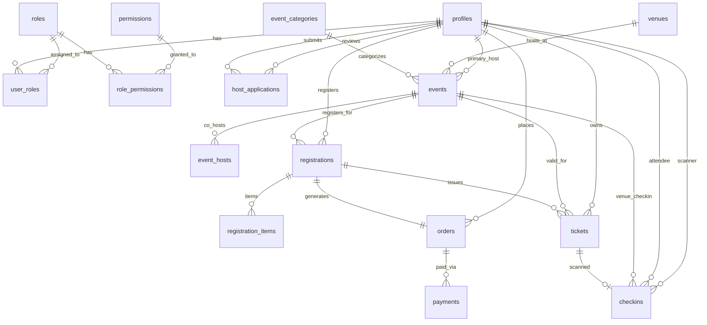

# The Social Scene — Backend & Database System of Record

The core backend system of record for **The Social Scene** platform, powered by Supabase PostgreSQL, Row-Level Security (RLS) policies, database triggers, stored RPC procedures, and shared TypeScript domain services.

---

## 🛠️ Architecture & Services

The backend architecture consists of canonical Supabase SQL migrations alongside typed backend service modules:

```text
backend/
├── services/
│   ├── analytics.service.ts       # Platform KPIs, revenue tracking & registration stats
│   ├── audit.service.ts           # Centralized audit logging for administrative actions
│   ├── checkin.service.ts         # Ticket verification, check-in validation & attendance
│   ├── event.service.ts           # Event creation, publishing, capacity management
│   ├── notification.service.ts    # Resend email & customer notification delivery
│   ├── payment.service.ts         # Razorpay order generation & payment verification
│   └── ticket.service.ts          # Pass generation, QR payload signing & ticket codes
│
├── supabase/
│   ├── migrations/                # 17 sequential PostgreSQL schema migrations
│   └── seed.sql                   # Development seed data for categories & roles
│
└── types/
    ├── database.types.ts          # Auto-generated Supabase database type definitions
    └── rbac.types.ts              # Multi-role RBAC permissions & role type interfaces
```

---

## 🗄️ Database Migrations (`backend/supabase/migrations/`)

1. `00001_initial_schema.sql` — Profiles, Events, Registrations, Orders, Payments, Tickets.
2. `00002_functions_triggers.sql` — Capacity locking triggers & timestamp procedures.
3. `00003_auth_profile_and_rls.sql` — Supabase Auth linkage & RLS policies.
4. `00004_public_event_access.sql` — Visibility rules for published events.
5. `00005_remove_demo_venues.sql` — Clean up initial seed venue entries.
6. `00006_security_hardening.sql` — Harden RLS checks and sensitive columns.
7. `00007_auth_hardening_and_dashboard_rbac.sql` — Initial RBAC schema setup.
8. `00008_firebase_phone_auth.sql` — Firebase UID integration bridge.
9. `00009_razorpay_and_checkin.sql` — Razorpay orders & check-in scanner RPC functions.
10. `00010_payment_webhook_idempotency.sql` — Webhook event deduplication table.
11. `00011_security_harden_rpc_execution.sql` — Restrict RPC function execution security.
12. `00012_revoke_public_rpc_execute.sql` — Revoke execute permissions on administrative RPCs from public roles.
13. `00013_user_identity_onboarding.sql` — Profile onboarding & completion attributes.
14. `00014_host_applications_and_dashboard_access.sql` — Host application processing & approval workflows.
15. `00015_unify_dashboard_auth_with_existing_profiles.sql` — Single user profile model for public & dashboard.
16. `00016_dashboard_access_status_rbac.sql` — Access status controls (`ACTIVE`, `DEACTIVATED`, `SUSPENDED`).
17. `00017_multi_role_rbac.sql` — Multi-role RBAC framework allowing concurrent role assignments per user.

---

## ⚡ Stored RPC Functions & Triggers

- `check_in_ticket(p_ticket_code, p_scanned_by)`: Verifies ticket validity, checks double check-ins, creates check-in record, and returns attendee details.
- `lock_event_capacity(p_event_id, p_requested_qty)`: Prevents race conditions during concurrent checkouts by locking capacity.
- `has_permission(p_user_id, p_permission_key)`: Evaluates user's assigned roles against granted permissions.
- `get_user_permissions(p_user_id)`: Fetches consolidated array of active permission keys for authorization guards.

---

## 📊 Database ER Diagram Overview



> 📖 **Full Database Specification:** See [`docs/database-er-diagram.md`](file:///d:/Freelance/Project-12%20%28TheSocialScene/docs/database-er-diagram.md) for detailed domain ER diagrams.
