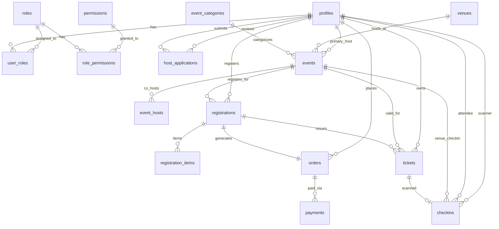

# ⚙️ The Social Scene — Backend Architecture & Database System of Record

The core relational database system of record, Supabase PostgreSQL migrations, Row-Level Security (RLS) policies, database triggers, stored RPC procedures, and shared TypeScript domain services for **The Social Scene** monorepo.

---

## 📖 Table of Contents
1. [Backend Overview](#-backend-overview)
2. [Database Schema & Migrations Catalog](#-database-schema--migrations-catalog)
3. [Stored RPC Functions & Triggers](#-stored-rpc-functions--triggers)
4. [TypeScript Domain Services Map](#-typescript-domain-services-map)
5. [Database ER Diagram Overview](#-database-er-diagram-overview)
6. [Security & Row-Level Security (RLS)](#-security--row-level-security-rls)

---

## 🎯 Backend Overview

The backend acts as the single source of truth for the entire platform. Built on **Supabase PostgreSQL**, it enforces data integrity, atomic capacity locks during checkout, double check-in prevention, and server-side permission checks across all API requests.

---

## 🗄️ Database Schema & Migrations Catalog

Migrations reside in `backend/supabase/migrations/` and must be applied sequentially:

| Migration File | Description & Relational Purpose |
| :--- | :--- |
| `00001_initial_schema.sql` | Core domain entities: `profiles`, `events`, `registrations`, `orders`, `payments`, `tickets`. |
| `00002_functions_triggers.sql` | Capacity locking triggers, reservation validation, and `updated_at` timestamps. |
| `00003_auth_profile_and_rls.sql` | Integrates Supabase Auth with `profiles` table and defines base RLS policies. |
| `00004_public_event_access.sql` | RLS visibility rules allowing public reading of published events. |
| `00005_remove_demo_venues.sql` | Schema cleanup removing initial development venue entries. |
| `00006_security_hardening.sql` | Hardens column permissions and security privileges across public tables. |
| `00007_auth_hardening_and_dashboard_rbac.sql` | Introduces initial RBAC tables (`roles`, `permissions`, `user_roles`). |
| `00008_firebase_phone_auth.sql` | Bridge linking Firebase `firebase_uid` with Supabase profile rows. |
| `00009_razorpay_and_checkin.sql` | Razorpay order structures and stored procedure `check_in_ticket`. |
| `00010_payment_webhook_idempotency.sql` | Creates `payment_webhook_events` to prevent duplicate webhook processing. |
| `00011_security_harden_rpc_execution.sql` | Restricts execution rights on administrative RPC procedures. |
| `00012_revoke_public_rpc_execute.sql` | Revokes public execute access on administrative RPC functions. |
| `00013_user_identity_onboarding.sql` | Profile completion attributes (`onboarding_completed`, `age` checks). |
| `00014_host_applications_and_dashboard_access.sql` | Table `host_applications` for managing creator proposals. |
| `00015_unify_dashboard_auth_with_existing_profiles.sql` | Merges public and dashboard account profiles into a single model. |
| `00016_dashboard_access_status_rbac.sql` | Adds user access status column (`ACTIVE`, `DEACTIVATED`, `SUSPENDED`). |
| `00017_multi_role_rbac.sql` | Multi-role RBAC schema supporting concurrent roles per user. |

---

## ⚡ Stored RPC Functions & Triggers

### 1. `check_in_ticket(p_ticket_code, p_scanned_by)`
- **Purpose:** Executes atomic ticket check-in during venue entry.
- **Behavior:** Checks if the ticket exists and is `ACTIVE`. If valid, updates ticket status to `CHECKED_IN`, inserts a record in `checkins`, logs an entry in `attendance_events`, and returns attendee details. If already scanned, throws a controlled double check-in error.

### 2. `lock_event_capacity(p_event_id, p_requested_qty)`
- **Purpose:** Prevents race conditions during concurrent checkouts.
- **Behavior:** Locks the event row using PostgreSQL `FOR UPDATE`, checks if `registered_count + p_requested_qty <= capacity`, increments `registered_count`, and returns success.

### 3. `has_permission(p_user_id, p_permission_key)`
- **Purpose:** Evaluates whether a user holds a specific permission key across all assigned multi-roles.

---

## 📁 TypeScript Domain Services Map

```text
backend/services/
├── analytics.service.ts       # Revenue calculation & registration volume tracking
├── audit.service.ts           # Audit log entry recorder ('audit_logs')
├── checkin.service.ts         # Ticket scanning & validation service
├── event.service.ts           # Event creation, drafting, publishing & capacity logic
├── notification.service.ts    # Resend email notification delivery
├── payment.service.ts         # Razorpay order generation & payment capture
└── ticket.service.ts          # Pass generation & QR payload cryptography
```

---

## 📊 Database ER Diagram Overview



> 📖 **Field-Level Specifications:** See [`docs/database-er-diagram.md`](file:///d:/Freelance/Project-12%20%28TheSocialScene/docs/database-er-diagram.md) for full field-level diagrams.
