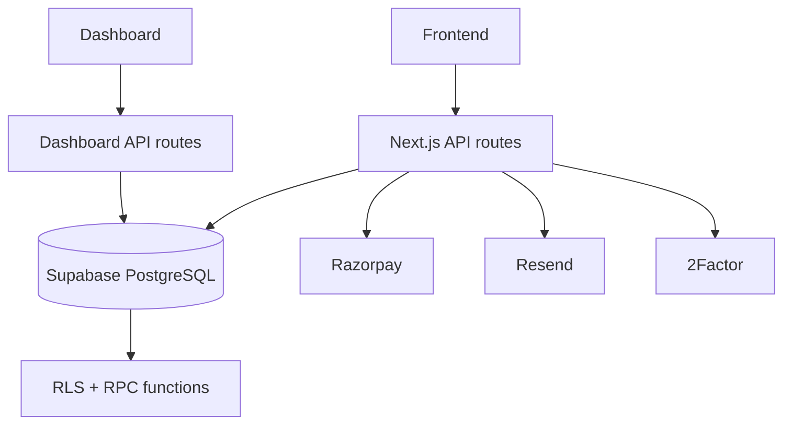

# The Social Scene — Backend & Database

The `backend/` directory is the canonical repository location for the platform's PostgreSQL schema, Supabase migrations, shared database types and domain-oriented services.

## Current Architecture



Supabase PostgreSQL is the current production system of record. Firebase remains the public identity provider; Firebase authentication does not replace the relational `profiles` data model.

## Directory

```text
backend/
├── lib/
│   └── validation/       # Shared Zod request schemas
├── services/              # Domain service implementations
├── supabase/
│   └── migrations/        # Canonical schema migration history
├── types/                 # Shared/generated database types
├── package.json
└── README.md
```

## Domain Services

Current service areas include:

- Analytics.
- Audit logging.
- Event operations.
- Check-in.
- Notifications.
- Payments.
- Tickets.

These services encapsulate domain behavior used by application layers and should not become a second database source of truth.

## Database Domains

The current PostgreSQL model includes:

- `profiles` and identity/onboarding state.
- `roles`, `permissions`, `user_roles`, `role_permissions`.
- `host_applications`.
- `event_categories`, `events`, `venues`, `event_hosts`.
- Event tags/wishlist-related tables.
- `registrations`, `registration_items`.
- `orders`, `payments`, `payment_webhook_events`.
- `tickets`.
- `checkins`, `attendance_events`.
- Audit records.

Refer to `docs/database-er-diagram.md` for the field-level relationship map.

## Migration History

The migration directory contains the authoritative schema evolution, including authentication/RLS hardening, Firebase identity integration, Razorpay/check-in support, webhook idempotency, host applications, dashboard RBAC, performance indexes and search-latency indexes.

Do not rewrite old migrations simply to make numbering or naming look cleaner. Add a new migration for a new schema change.

## Security Model

The database is part of the authorization boundary.

- RLS policies protect user-facing data access.
- RPC execution privileges are explicitly hardened.
- Administrative operations require authenticated/authorized server paths.
- Service-role access is server-side only.
- Payment webhook processing is idempotent.
- Check-in is validated atomically at the database boundary.

## Authentication Relationship

```text
Firebase identity
      │
      ▼
Firebase UID
      │
      ▼
Supabase profiles.firebase_uid
      │
      ├── onboarding state
      ├── contact information
      ├── roles
      └── event/ticket ownership
```

The public session endpoint verifies Firebase identity and synchronizes/reads the corresponding relational profile.

## Payment Relationship

```text
Razorpay order
      │
      ▼
application order
      │
      ▼
payment record
      │
      ▼
registration
      │
      ▼
ticket
```

Webhook idempotency records prevent a replayed Razorpay event from creating duplicate business records.

## Check-In Relationship

A ticket can produce at most the valid check-in state allowed by the database procedure. Scanner UI feedback must always reflect server/database results.

## Performance

Recent database performance work includes indexes for event/tag lookup and search paths. Search query execution has been measured at millisecond/sub-millisecond database execution times in direct database testing; end-user API latency can still be higher because it includes application runtime and network/provider overhead.

## Development Rules

1. Make schema changes through migrations.
2. Keep RLS and RPC privileges aligned with application authorization.
3. Test migrations against a safe database before production.
4. Regenerate shared types after schema changes.
5. Run affected application production builds.
6. Verify booking, payment, ticket and check-in invariants after financial/schema changes.

## Current External Integrations

| Integration | Purpose |
|---|---|
| Firebase | Public identity/authentication |
| 2Factor | Phone OTP verification |
| Razorpay | Payments |
| Resend | Transactional/admin email |
| Google Analytics | Web telemetry |
| Vercel | Application hosting |

## Documentation Visuals

Use Mermaid ER/flow diagrams for architecture documentation. If screenshots are added, store them in `docs/images/` and use relative Markdown references so documentation remains portable across machines and GitHub.
