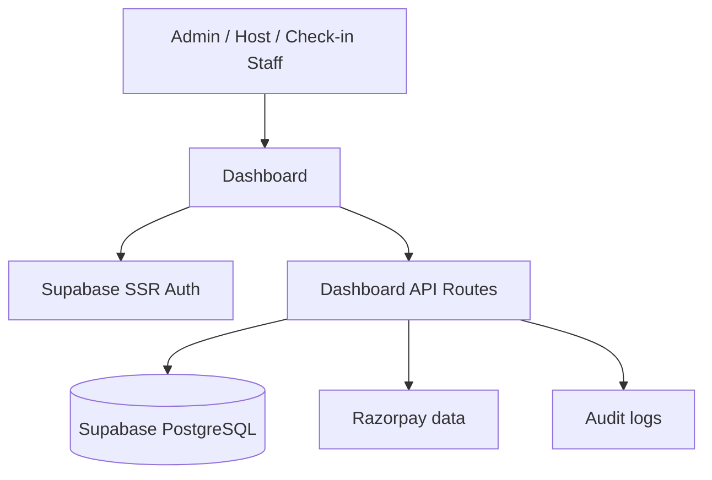
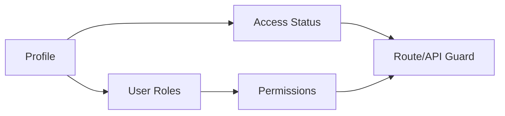
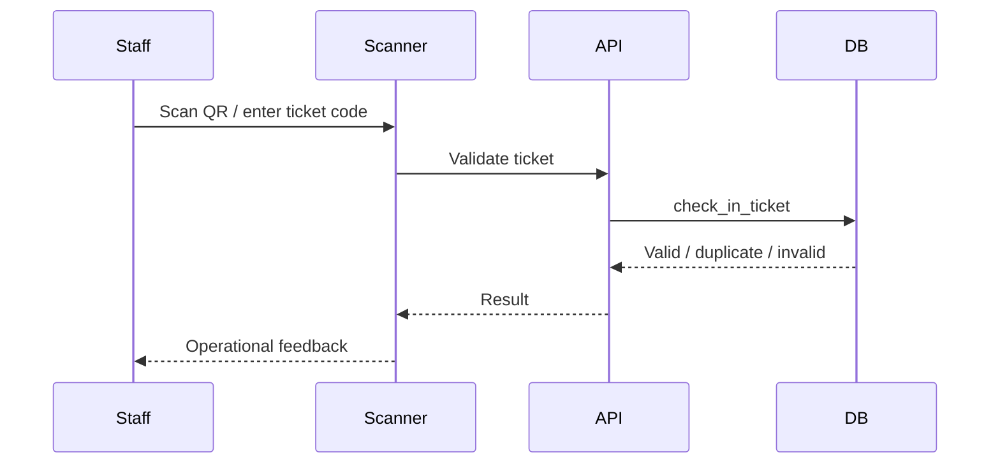

# The Social Scene — Operations & Host Dashboard

The `dashboard/` application is the private operations portal for platform administrators, hosts and authorized check-in staff.

**Production:** `https://admin.thesocialscene.club`  
**Local:** `http://localhost:3001`

## Current Stack

- Next.js `16.3.2` App Router.
- React `19.2.8`.
- TypeScript.
- Tailwind CSS v4.
- Supabase SSR authentication.
- Supabase PostgreSQL data access.
- Recharts for operational analytics.
- `html5-qrcode` for ticket scanning.
- Firebase integration where shared identity context is required by current platform flows.

## Architecture



## Current Operational Areas

| Area | Purpose |
|---|---|
| Overview | KPIs and operational snapshot |
| Analytics | Revenue, registrations, attendance and related metrics |
| Events | Event listing, editing and publishing |
| Event creation | Multi-step event setup |
| Registrations | Attendee/registration operations |
| Hosts | Host applications and host account operations |
| Users | User directory, roles and access state |
| Payments | Orders/payment visibility |
| Scanner / Check-in | QR and manual ticket validation |
| Audit logs | Administrative action history |
| Settings | Account/application configuration |

## Authentication & Authorization

Dashboard access uses Supabase SSR authentication and server-side authorization checks.

The authorization model separates:

1. **Identity** — authenticated profile.
2. **Roles** — one or more assigned roles.
3. **Permissions** — fine-grained actions available to roles.
4. **Access status** — account operational state.

Current role concepts include `SUPER_ADMIN`, `ADMIN`, `HOST`, `CHECKIN_STAFF` and `USER`.

Access status is separate from role and can include `ACTIVE`, `DEACTIVATED` and `SUSPENDED`.



Never rely only on client-side button visibility for authorization. API handlers and server components must enforce permissions.

## Event Management

Authorized users can create and manage event records including:

- Basic event information.
- Category/vibe.
- Schedule.
- Venue.
- Capacity.
- Pricing/currency.
- Cover/gallery media.
- Host/co-host assignment.
- Instructions/rules.
- Publishing state.

Capacity and financial values must be read from authoritative database state.

## Host Applications

The dashboard provides access to submitted host applications. Applications are persisted in the PostgreSQL `host_applications` table.

The public application endpoint also sends an administrative Resend notification to `support@thesocialscene.club`. Email delivery is a notification concern; the database record remains the authoritative application record.

## User Management

The users area supports viewing and updating user access according to authorization.

A user can have multiple roles concurrently. UI and API code must therefore treat roles as a collection, not a single enum field.

Typical administrative operations include:

- View user profile.
- Assign/remove supported roles.
- Change access status.
- Review host-related access.
- Manage dashboard invitations where enabled.

All sensitive operations should be auditable.

## Scanner / Check-In



The scanner supports camera-based QR scanning and manual fallback. The database procedure is the authoritative validator and prevents duplicate check-in.

## Analytics

The dashboard consumes application analytics services for operational KPIs. Metrics should be derived from database state and should clearly distinguish gross transaction activity, registrations and actual attendance.

Google Analytics/GA4 is a separate web-telemetry source and should not be treated as the financial source of truth.

## Security Rules

- Keep Supabase service-role credentials server-side.
- Protect dashboard routes and API handlers.
- Enforce role/permission checks on sensitive operations.
- Preserve RLS/RPC security at the database layer.
- Do not trust client-submitted role/status values.
- Log sensitive administrative mutations.

## Development

```bash
cd dashboard
npm install
npm run dev -- -p 3001
```

Production build:

```bash
npm run build
npm run start
```

## Visual Documentation

Mermaid is used for current architecture and sequence diagrams. Stable UI screenshots may be stored under `../docs/images/` and referenced from this document once they match the current dashboard build.
