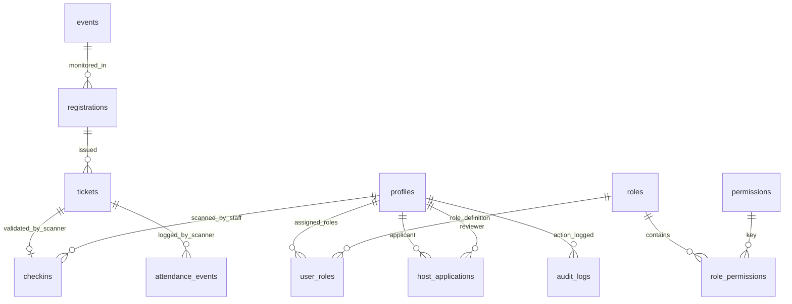

# 🛡️ The Social Scene — Operations & Host Dashboard

The private administration portal for **The Social Scene** platform, accessible in production at `https://admin.thesocialscene.club` (or `http://localhost:3001` during local development).

[](https://nextjs.org/)
[](https://react.dev/)
[](https://recharts.org/)
[](https://github.com/mebjas/html5-qrcode)

---

## 📖 Table of Contents
1. [Portal Purpose](#-portal-purpose)
2. [Key Operational Features](#-key-operational-features)
3. [Security Architecture & Route Guarding](#-security-architecture--route-guarding)
4. [Dashboard Directory & File Structure](#-dashboard-directory--file-structure)
5. [Data Flow & Scanner Integration](#-data-flow--scanner-integration)
6. [Database ER Diagram Overview](#-database-er-diagram-overview)
7. [Setup & Execution Guide](#-setup--execution-guide)

---

## 🎯 Portal Purpose

The Dashboard is designed specifically for **Platform Admins**, **Event Hosts**, and **Operational Venue Check-In Staff**. It allows authorized personnel to:
- Monitor registration volumes, revenue streams, and attendance metrics.
- Create and edit complex 9-stage event listings (pricing, schedules, categories, venues).
- Review incoming community host application proposals (`/host-applications`).
- Perform live camera-based ticket scanning at event entrances.
- Manage user permissions and access statuses (`ACTIVE`, `DEACTIVATED`, `SUSPENDED`) via Multi-Role RBAC.

---

## 🚀 Key Operational Features

### 1. 📊 Operations Telemetry Overview (`/`)
- Powered by **Recharts 3.10**.
- Displays key performance indicators (KPIs): Total Revenue, Registrations, Active Events, and Host Applications.
- Interactive volume graphs comparing daily ticket purchases and check-in rates.

### 2. 🪄 9-Section Event Creator Wizard (`/events/create`)
- Multi-step form allowing administrators and hosts to configure:
  1. Event Title & Slug
  2. Short & Detailed Descriptions
  3. Category & Venue Selection
  4. Event Timing (Start, End, Registration Deadline)
  5. Pricing & Currency (INR)
  6. Capacity & Multi-Ticket Allocation
  7. Cover Image Upload & Gallery Media
  8. Co-Host Assignments
  9. Detailed Event Schedule / Itinerary Items

### 3. 📷 Live Camera QR Ticket Scanner (`/scanner`)
- Utilizes **`html5-qrcode` 2.3** to access the device's camera.
- Scans event pass QR codes and sends signed payloads to the backend RPC procedure `check_in_ticket`.
- **Double Check-In Protection:** Prevents duplicate entry by returning immediate visual feedback if a ticket was already scanned.
- **Manual Input Fallback:** Allows typing ticket codes manually if camera scanning is unavailable or damaged.

### 4. 👥 Multi-Role Access Control (RBAC) & User Management (`/users`)
- Super Admins can view the user directory and manage roles via [`AccessActionMenu`](file:///d:/Freelance/Project-12%20%28TheSocialScene/dashboard/components/access/AccessActionMenu.tsx).
- Supports concurrent role assignments per account (e.g. `HOST` + `ADMIN`).
- Implements access status controls:
  - `ACTIVE`: Normal operational status.
  - `DEACTIVATED`: Temporary access freeze.
  - `SUSPENDED`: Administrative lockdown.

---

## 🔒 Security Architecture & Route Guarding

```text
[Incoming User Request]
          │
          ▼
[DashboardRouteGuard Middleware Check]
          │
          ├──> Unauthenticated? ──> Redirect to /login
          │
          ├──> Inactive/Suspended Status? ──> Redirect to /unauthorized
          │
          └──> Authorized Roles/Permissions? ──> Render Dashboard View
```

- **Server Authentication:** Built on `@supabase/ssr` with HttpOnly server cookies to prevent token leakage.
- **Route Guard Component:** [`DashboardRouteGuard.tsx`](file:///d:/Freelance/Project-12%20%28TheSocialScene/dashboard/components/layout/DashboardRouteGuard.tsx) wraps protected dashboard views and checks user permissions prior to layout execution.

---

## 📁 Dashboard Directory & File Structure

```text
dashboard/
├── app/
│   ├── (auth)/login/               # Administrative email/password login
│   ├── (dashboard)/
│   │   ├── analytics/              # Deep telemetry charts & attendance exports
│   │   ├── audit-logs/             # System audit trail logs
│   │   ├── checkin/                # Manual check-in overview
│   │   ├── events/                 # Event directory & multi-step creation wizard
│   │   ├── hosts/                  # Host accounts & application review portal
│   │   ├── payments/               # Razorpay order captures & transactions
│   │   ├── registrations/          # Attendee lists & CSV exporter
│   │   ├── scanner/                # Live camera video feed scanner
│   │   ├── users/                  # User directory & multi-role assignment UI
│   │   └── page.tsx                # Dashboard KPI overview homepage
│   └── api/                        # Protected Next.js API route handlers
│
├── components/
│   ├── access/AccessActionMenu.tsx # Role assignment & access status dropdown
│   └── layout/
│       ├── DashboardHeader.tsx     # Admin navbar with profile menu
│       ├── DashboardRouteGuard.tsx # Role permission checking wrapper
│       └── DashboardSidebar.tsx    # Responsive navigation sidebar
│
└── lib/
    ├── auth.ts                     # Server-side authentication helpers
    └── dashboard-rbac.ts           # Permission key verification logic
```

---

## 📊 Database ER Diagram Overview

Below is the relationship diagram representing backend entities managed by the Dashboard:



> 📖 **Field-Level Specifications:** See [`docs/database-er-diagram.md`](file:///d:/Freelance/Project-12%20%28TheSocialScene/docs/database-er-diagram.md) for complete database schema details.

---

## ⚡ Setup & Execution Guide

### 1. Install Dependencies
```bash
cd dashboard
npm install
```

### 2. Configure Environment Variables
Copy `.env.example` to `.env.local`:
```bash
copy .env.example .env.local
```

### 3. Run Development Server
```bash
# Runs dashboard on port 3001 to prevent conflicts with frontend (port 3000)
npm run dev -- -p 3001
```
Open `http://localhost:3001` in your browser.
