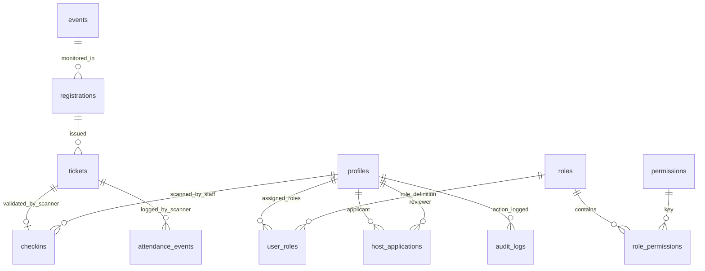

# The Social Scene — Operations & Host Dashboard

Private administration portal for hosts, event managers, and check-in staff (`https://admin.thesocialscene.club`).

[](https://nextjs.org/)
[](https://recharts.org/)
[](https://github.com/mebjas/html5-qrcode)

---

## 🔑 Key Features Implemented

- **Operations Telemetry Overview:** Real-time KPI summary cards and interactive Recharts graphs tracking revenue metrics and registration volume trends.
- **Event Creator Wizard:** 9-step administrative form for configuring event metadata, schedules, venue details, pricing, tickets, and cover imagery.
- **Camera Check-In Scanner:** Dedicated operational scanner utilizing `html5-qrcode` to capture camera video feed, verify pass QR payloads via server RPC, provide manual ticket code input fallback, and prevent duplicate check-ins.
- **Multi-Role Access Control (RBAC):** Server-enforced authorization supporting multiple simultaneous roles per account (`SUPER_ADMIN`, `ADMIN`, `HOST`, `CHECKIN_STAFF`, `USER`).
- **User & Access Management:** Interactive [`AccessActionMenu`](file:///d:/Freelance/Project-12%20%28TheSocialScene/dashboard/components/access/AccessActionMenu.tsx) component allowing Super Admins to assign/revoke roles and modify access status (`ACTIVE`, `DEACTIVATED`, `SUSPENDED`).
- **Host Applications Portal:** View, review, approve, or reject incoming host application proposals submitted through the public website.
- **Registrations & Financials:** Full attendee rosters, CSV export functionality, transaction logs, and Razorpay payment status tracking.

---

## 🔒 Security & Route Protection

- **Route Guarding:** [`DashboardRouteGuard`](file:///d:/Freelance/Project-12%20%28TheSocialScene/dashboard/components/layout/DashboardRouteGuard.tsx) validates the user's active session and evaluates permissions before rendering protected pages.
- **Server Authentication:** Built on `@supabase/ssr` with HttpOnly server cookies to prevent token theft or unauthorized API execution.
- **Permission Checking:** Backend API routes verify permissions against `00017_multi_role_rbac.sql` database policies.

---

## 📊 Dashboard RBAC & Data Model ER Diagram



> 📖 **Full Database Specification:** See [`docs/database-er-diagram.md`](file:///d:/Freelance/Project-12%20%28TheSocialScene/docs/database-er-diagram.md) for field-level database diagrams.

---

## ⚡ Local Development Setup

```bash
# Install dependencies
npm install

# Configure environment credentials
copy .env.example .env.local

# Run dashboard on port 3001
npm run dev -- -p 3001
# Open http://localhost:3001
```
