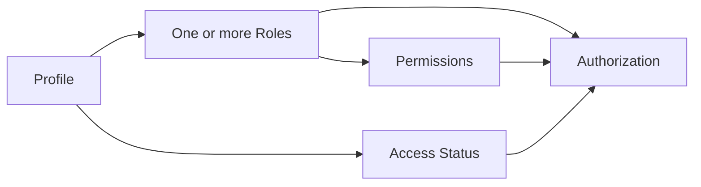

# Admin & User Management — Current System

This document describes the currently implemented administrative user/access model.

## Access Model

The dashboard separates four concepts:



### Roles

Current role concepts include:

- `SUPER_ADMIN` — highest administrative authority.
- `ADMIN` — normal platform administration.
- `HOST` — host/event operations permitted by assigned permissions.
- `CHECKIN_STAFF` — venue check-in operations.
- `USER` — public attendee account.

The database supports multiple role assignments per profile.

### Access status

Role does not automatically mean an account is active. Current account states include:

- `ACTIVE`
- `DEACTIVATED`
- `SUSPENDED`

Access status is evaluated independently of role assignment.

## Current Dashboard Operations

Authorized users can manage, subject to permission:

- User directory.
- User profile information.
- Role assignments.
- Access status.
- Host applications.
- Event ownership/host assignment.
- Administrative invitations where enabled.

Sensitive mutations should be audit logged.

## Host Application Relationship

```mermaid
flowchart TD
    APPLICANT[Public applicant] --> FORM[/become-a-host]
    FORM --> API[/api/host-applications]
    API --> DB[(host_applications)]
    API --> EMAIL[Resend notification]
    DB --> REVIEW[Dashboard review]
```

The database record is authoritative. Current notification recipient is `support@thesocialscene.club`.

## Authorization Rules

UI visibility is not authorization. Every sensitive API action must verify:

1. Authenticated identity.
2. Account access status.
3. Required role/permission.
4. Resource ownership/scope where applicable.

## User CRUD Safety

When changing a user:

- Do not allow an administrator to accidentally remove the final required platform administrator.
- Validate role values against supported roles.
- Keep access status changes explicit.
- Invalidate/re-evaluate access where the implementation requires it.
- Record sensitive changes in audit logs.

## Operational UI

The users interface should expose enough context for administrators to understand:

- Who the user is.
- Which roles are assigned.
- Whether the account is active.
- What access the selected role/permission grants.
- What action will be performed before confirmation.

## Visual Model

```text
User
 ├── Identity/Profile
 ├── Roles [ADMIN, HOST, ...]
 ├── Access Status [ACTIVE/...]
 └── Permission-effective actions
```

Use Mermaid or current screenshots for visual documentation. Store stable screenshots under `docs/images/` if added.
