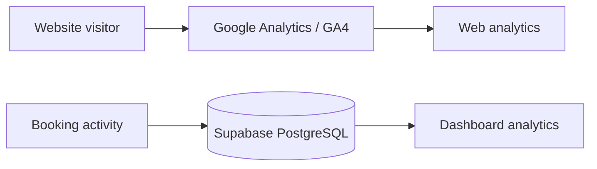

# Analytics — Current System

The Social Scene currently has two related analytics surfaces:

1. **GA4/web telemetry** for visitor and interaction analytics.
2. **Dashboard operational analytics** derived from application/database data.

They serve different purposes and should not be treated as interchangeable sources of truth.

## Architecture



## Operational Metrics

Dashboard metrics can cover areas such as:

- Revenue.
- Registrations.
- Tickets.
- Event activity.
- Attendance/check-ins.
- Host/application activity.

Financial metrics should be calculated from authoritative order/payment records rather than browser telemetry.

## GA4

GA4 is intended for:

- Page views.
- Navigation.
- Event discovery interactions.
- Conversion funnel telemetry.
- Marketing attribution where configured.

The frontend contains a dedicated Google Analytics integration component. GA4 should not be used to determine whether a booking/payment actually succeeded.

## Current Authentication Boundary

Dashboard analytics provider calls are server-side operations. Credentials and service-account material must never be exposed to the browser.

A production issue was observed on the realtime Google Analytics endpoint:

```text
GET /api/analytics/realtime?provider=google
500 Internal Server Error
Unable to authenticate with Google Analytics.
```

This means the analytics integration can exist while the Google provider authentication is unhealthy. It does not imply that Supabase query performance is the cause.

## Data Integrity

For operational reporting:

```text
Orders → Payments → Registrations → Tickets → Check-ins
```

Use database state for financial and attendance reporting. GA4 remains behavioral telemetry.

## Analytics QA

Verify:

- GA4 measurement ID configuration.
- Page-view behavior across client navigation.
- Event names and payload consistency.
- No duplicate page-view events after route transitions.
- Dashboard provider authentication.
- Graceful provider failure handling.
- Timezone/date-range correctness.
- Revenue calculations against database records.

## Performance

Analytics must not block critical user interactions. Provider requests should be isolated from primary booking/discovery paths and should fail gracefully.

## Visuals

Use Mermaid for the architecture. Current dashboard screenshots can be placed under `docs/images/analytics/` when stable screenshots are available and should be linked with relative Markdown paths.
