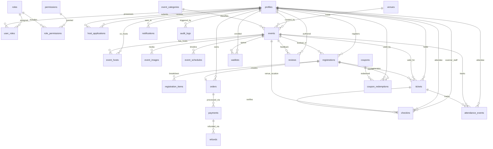
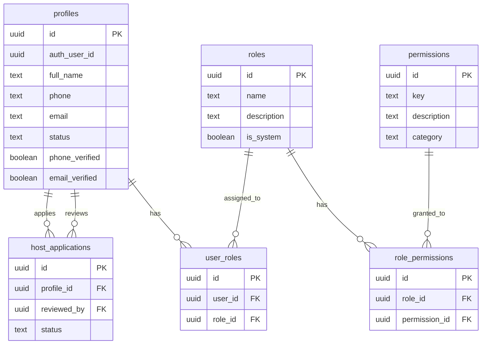
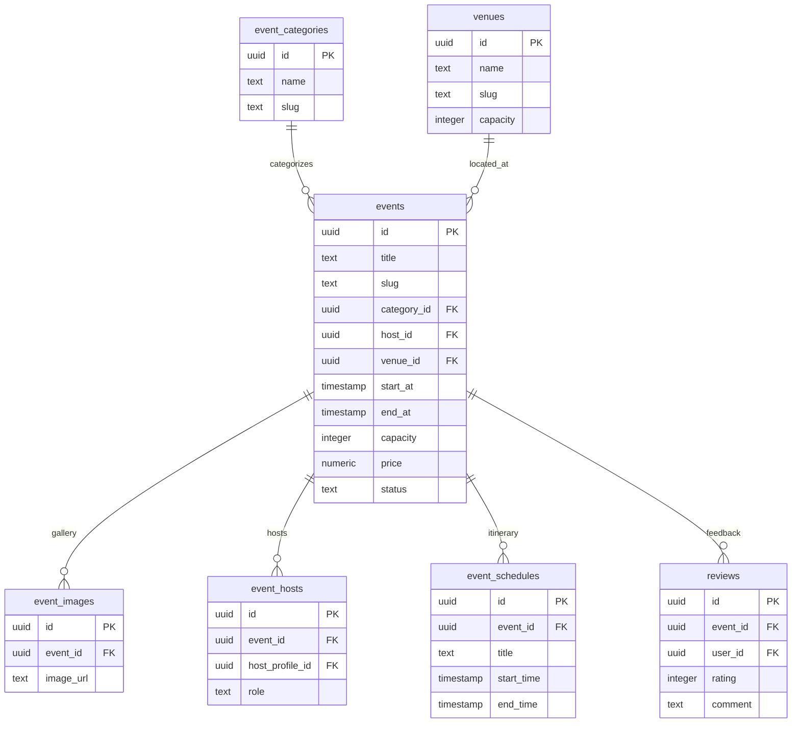
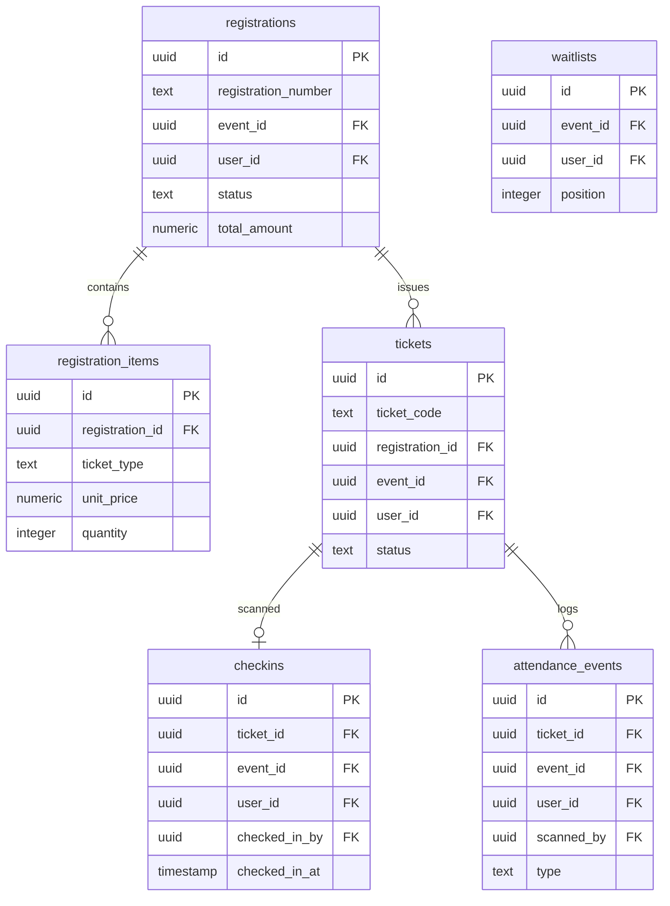
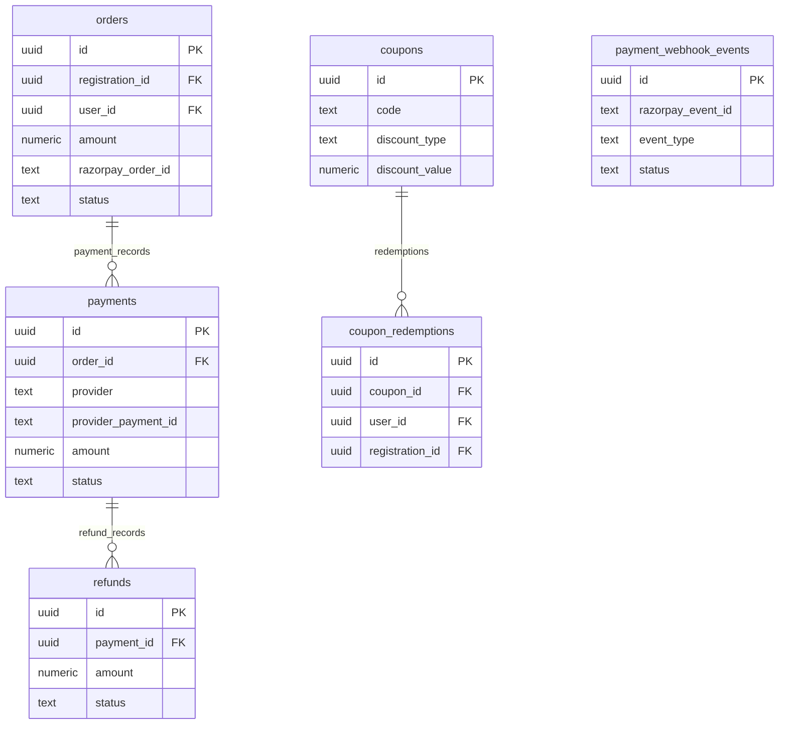

# Database Entity-Relationship (ER) Diagram & Architecture Specification

This document details the relational database schema for **The Social Scene** platform built on Supabase PostgreSQL.

---

## 🏗️ High-Level Relational Schema Overview

---

## 🛡️ 1. User Identity & Multi-Role RBAC Domain

---

## 🎪 2. Event Operations & Venue Management Domain

---

## 🎟️ 3. Registrations, Ticketing & Venue Check-In Domain

---

## 💳 4. Orders, Payments & Financial Operations Domain

