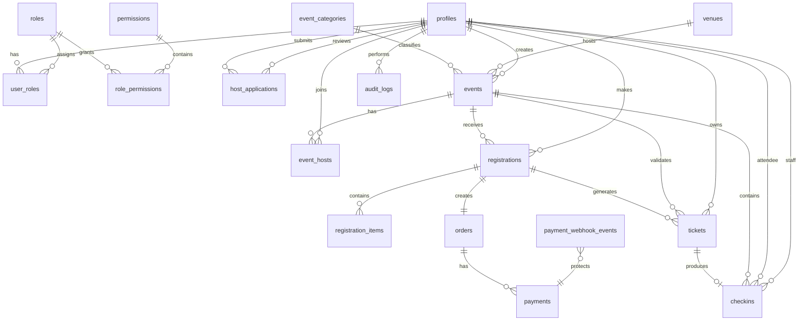
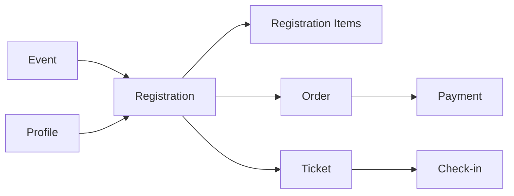

# The Social Scene — Current Database Model

The production relational database is **PostgreSQL managed by Supabase**. This document describes the current application data model and its major relationships.

## Architecture



## Identity & Access

### `profiles`

Application-level user profile associated with the Firebase identity used by the public application and the dashboard identity model.

Contains user-facing identity, contact and onboarding/access information.

### `roles`, `permissions`

Define the available authorization vocabulary.

### `user_roles`

Join table allowing a profile to hold multiple roles simultaneously.

### `role_permissions`

Maps roles to fine-grained permissions.

## Host Operations

### `host_applications`

Stores public host applications and their review state. The application is submitted through the public website and reviewed through the dashboard.

The database record is authoritative; Resend is the administrative notification mechanism.

## Event Domain

### `event_categories`

Active/inactive category taxonomy for event discovery.

### `events`

Primary experience record. Includes title/slug, descriptions, publication state, schedule, capacity, registration state, pricing, cover media and references to category/venue/creator.

### `venues`

Venue identity/location data used by event pages and operations.

### `event_hosts`

Associates hosts/co-hosts with events.

### Event tags/wishlist data

The schema also contains event-tag and wishlist-related structures supporting discovery and user interest features.

## Booking Domain



### `registrations`

Represents the booking/registration relationship between a profile and an event.

### `registration_items`

Stores the item-level breakdown for a registration where applicable.

### `orders`

Application-side order record associated with a registration.

### `payments`

Payment state and provider-related financial record.

### `payment_webhook_events`

Idempotency/event-processing record for Razorpay webhook payloads. It prevents duplicate processing of the same provider event.

### `tickets`

Digital admission credential generated from successful booking/payment processing.

## Attendance Domain

### `checkins`

Records ticket entry validation.

### `attendance_events`

Operational attendance/event history generated by check-in activity where applicable.

The database check-in procedure is authoritative for whether a ticket is valid and whether it has already been checked in.

## Audit Domain

### `audit_logs`

Records sensitive administrative/system actions for operational accountability.

## Security

Supabase RLS policies and RPC execution privileges are part of the security model. Application code must not assume that a client-side role check is sufficient.

Sensitive service-role access remains server-side.

## Migration Source

The canonical migration history is under:

```text
backend/supabase/migrations/
```

Migrations cover the current schema, RLS/security hardening, Firebase identity integration, payments, check-in, webhook idempotency, host applications, dashboard RBAC, performance indexes and search-related indexes.

Do not edit historical migrations to erase their history. Add new migrations for new schema changes.

## Visual Maintenance

This Mermaid diagram is the canonical high-level visual. If a static diagram is generated later, store it under `docs/images/database/` and keep the Mermaid representation as the editable source.
