# Database Entity-Relationship (ER) Diagram

This document contains the visual Entity-Relationship diagram for **The Social Scene** Supabase PostgreSQL relational database schema.

## 📊 Complete Database ER Diagram

```mermaid
erDiagram
    profiles {
        uuid id PK
        uuid auth_user_id
        text full_name
        text phone
        text email
        text status
        boolean phone_verified
        boolean email_verified
    }
    roles {
        uuid id PK
        text name
        text description
        boolean is_system
    }
    permissions {
        uuid id PK
        text key
        text description
        text category
    }
    user_roles {
        uuid id PK
        uuid user_id FK
        uuid role_id FK
    }
    role_permissions {
        uuid id PK
        uuid role_id FK
        uuid permission_id FK
    }
    event_categories {
        uuid id PK
        text name
        text slug
    }
    venues {
        uuid id PK
        text name
        text slug
        integer capacity
    }
    events {
        uuid id PK
        text title
        text slug
        uuid category_id FK
        uuid host_id FK
        uuid venue_id FK
        timestamp start_at
        timestamp end_at
        integer capacity
        numeric price
        text status
    }
    event_images {
        uuid id PK
        uuid event_id FK
        text image_url
    }
    event_hosts {
        uuid id PK
        uuid event_id FK
        uuid host_profile_id FK
        text role
    }
    event_schedules {
        uuid id PK
        uuid event_id FK
        text title
        timestamp start_time
        timestamp end_time
    }
    registrations {
        uuid id PK
        text registration_number
        uuid event_id FK
        uuid user_id FK
        text status
        numeric total_amount
    }
    registration_items {
        uuid id PK
        uuid registration_id FK
        text ticket_type
        numeric unit_price
        integer quantity
    }
    tickets {
        uuid id PK
        text ticket_code
        uuid registration_id FK
        uuid event_id FK
        uuid user_id FK
        text status
    }
    checkins {
        uuid id PK
        uuid ticket_id FK
        uuid event_id FK
        uuid user_id FK
        uuid checked_in_by FK
        timestamp checked_in_at
    }
    waitlists {
        uuid id PK
        uuid event_id FK
        uuid user_id FK
        integer position
        text status
    }
    orders {
        uuid id PK
        uuid registration_id FK
        uuid user_id FK
        numeric amount
        text status
        text razorpay_order_id
    }
    payments {
        uuid id PK
        uuid order_id FK
        text provider
        text provider_payment_id
        numeric amount
        text status
    }
    refunds {
        uuid id PK
        uuid payment_id FK
        numeric amount
        text status
    }
    coupons {
        uuid id PK
        text code
        text discount_type
        numeric discount_value
    }
    coupon_redemptions {
        uuid id PK
        uuid coupon_id FK
        uuid user_id FK
        uuid registration_id FK
    }
    reviews {
        uuid id PK
        uuid event_id FK
        uuid user_id FK
        integer rating
        text status
    }
    notifications {
        uuid id PK
        uuid user_id FK
        text type
        text title
    }
    audit_logs {
        uuid id PK
        uuid actor_user_id FK
        text action
        text entity_type
    }
    attendance_events {
        uuid id PK
        uuid ticket_id FK
        uuid event_id FK
        uuid user_id FK
        uuid scanned_by FK
        text type
    }
    payment_webhook_events {
        uuid id PK
        text razorpay_event_id
        text event_type
        text status
    }
    host_applications {
        uuid id PK
        uuid profile_id FK
        uuid reviewed_by FK
        text status
    }

    profiles ||--o{ user_roles : "has"
    roles ||--o{ user_roles : "assigned_to"
    roles ||--o{ role_permissions : "has"
    permissions ||--o{ role_permissions : "assigned_to"

    profiles ||--o{ host_applications : "applicant"
    profiles ||--o{ host_applications : "reviewer"

    event_categories ||--o{ events : "categorizes"
    venues ||--o{ events : "hosts_at"
    profiles ||--o{ events : "primary_host"
    profiles ||--o{ event_hosts : "co_host"
    events ||--o{ event_hosts : "co_hosts"
    events ||--o{ event_images : "gallery"
    events ||--o{ event_schedules : "schedule"

    events ||--o{ registrations : "registers_for"
    profiles ||--o{ registrations : "registers"
    registrations ||--o{ registration_items : "items"

    registrations ||--|| orders : "generates"
    profiles ||--o{ orders : "places"
    orders ||--o{ payments : "paid_via"
    payments ||--o{ refunds : "refunded_via"

    registrations ||--o{ tickets : "issues"
    events ||--o{ tickets : "valid_for"
    profiles ||--o{ tickets : "owns"

    tickets ||--o| checkins : "scanned"
    events ||--o{ checkins : "venue_checkin"
    profiles ||--o{ checkins : "attendee"
    profiles ||--o{ checkins : "scanner"

    tickets ||--o{ attendance_events : "logs"
    events ||--o{ attendance_events : "logs"
    profiles ||--o{ attendance_events : "attendee"
    profiles ||--o{ attendance_events : "scanner"

    events ||--o{ waitlists : "queue"
    profiles ||--o{ waitlists : "waits"

    coupons ||--o{ coupon_redemptions : "redeemed"
    profiles ||--o{ coupon_redemptions : "redeemed_by"
    registrations ||--o{ coupon_redemptions : "applied_to"

    events ||--o{ reviews : "reviewed"
    profiles ||--o{ reviews : "author"

    profiles ||--o{ notifications : "notified"
    profiles ||--o{ audit_logs : "actor"
```

## 📋 Core Modules Summary

1. **User Identity & RBAC:** `profiles`, `roles`, `permissions`, `user_roles`, `role_permissions`
2. **Event & Venue Management:** `event_categories`, `venues`, `events`, `event_images`, `event_hosts`, `event_schedules`
3. **Registration & Ticketing:** `registrations`, `registration_items`, `tickets`, `checkins`, `attendance_events`, `waitlists`
4. **Checkout & Financial Operations:** `orders`, `payments`, `refunds`, `coupons`, `coupon_redemptions`, `payment_webhook_events`
5. **Community & Platform Operations:** `reviews`, `notifications`, `audit_logs`, `host_applications`
