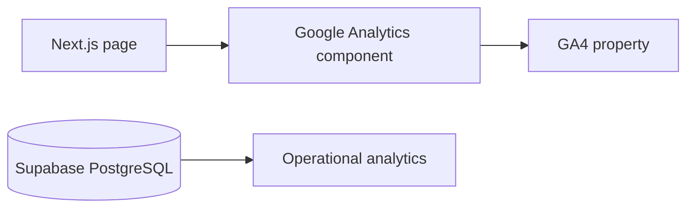

# Google Analytics 4 — Current Integration

This document describes the current GA4/web-analytics integration used by The Social Scene.

## Purpose

GA4 measures website behavior and marketing/conversion telemetry. It is not the authoritative source for orders, payments, tickets or attendance.

## Data Flow



## Client Configuration

Only browser-safe GA configuration may be exposed through `NEXT_PUBLIC_*` variables. Service-account credentials used by dashboard/server integrations must remain server-side.

Do not commit credentials, service-account JSON, access tokens or private keys.

## Recommended Event Taxonomy

The implementation should keep event names stable. Useful product events include:

- Event list viewed.
- Event detail viewed.
- Search performed.
- Category selected.
- Checkout started.
- Payment initiated.
- Booking completed.
- Host application submitted.

Where an event represents a successful business operation, the application database remains the authoritative source.

## SPA Navigation

Because the public site uses Next.js client navigation, page-view behavior must be verified across route transitions rather than only full browser reloads.

Test:

1. Load `/`.
2. Navigate to `/events` using a client link.
3. Open an event.
4. Return using client navigation.
5. Verify expected page-view/event behavior without duplicates.

## Privacy

Analytics implementation must follow the platform's applicable privacy requirements and should not send unnecessary personally identifiable information to GA4.

## Current Operational Note

The dashboard also has a Google Analytics provider integration for realtime analytics. A previously observed production failure returned:

```text
500 Unable to authenticate with Google Analytics.
```

This is a server/provider-authentication issue in the dashboard analytics path and is separate from the frontend GA4 browser telemetry path.

## QA Checklist

- Measurement ID is correct for production.
- No secret credentials are exposed client-side.
- Page views work with App Router navigation.
- Important product events are stable.
- No duplicate tracking after hydration/navigation.
- Analytics failures do not block booking or discovery.
- Dashboard Google provider authentication is independently verified.
