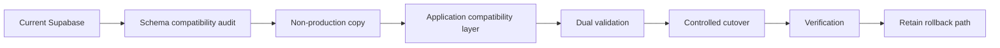

# Future Database Migration Suggestion

> **Status: FUTURE PLANNING ONLY.** This document does not describe the current production system.

## Current System

The Social Scene currently uses **Supabase PostgreSQL** as its production relational database and system of record. Firebase remains the public identity provider. The current application must continue to use the existing Supabase schema, RLS policies, RPC functions and migrations.

No Supabase-to-Neon migration is part of the current implementation.

## Why This Document Exists

If database hosting needs to change later for cost, scaling, operational control or architecture reasons, this document provides a staged migration approach without changing the current system prematurely.

## Potential Target

Neon PostgreSQL could be evaluated as a future PostgreSQL hosting target. Any future target must support the application's:

- Relational schema.
- Constraints and indexes.
- PostgreSQL functions/RPC logic.
- RLS/security requirements or an equivalent application security model.
- Transactions and locking used by booking/capacity logic.
- Payment/webhook idempotency records.
- Existing operational data volume.

## Proposed Future Migration Stages



### Stage 1 — Inventory

Record all tables, indexes, functions, triggers, RLS policies, extensions, storage dependencies and application queries.

### Stage 2 — Compatibility

Confirm PostgreSQL version/features and provider behavior. Pay special attention to RPC functions, locking, extensions and connection pooling.

### Stage 3 — Non-production copy

Copy schema and representative data to the candidate target. Validate row counts, foreign keys, indexes, constraints and application queries.

### Stage 4 — Application adaptation

Only after compatibility is proven, introduce the new server-side database connection mechanism. Do not expose database credentials to the browser.

Potential future environment shape:

```text
DATABASE_URL=...
DATABASE_URL_UNPOOLED=...
```

Never use a public browser variable such as `NEXT_PUBLIC_DATABASE_URL` for a database connection string.

### Stage 5 — Dual validation

Compare important outputs between old and new systems:

- Event listings.
- User/profile relationships.
- Registrations.
- Orders.
- Payments.
- Tickets.
- Check-ins.
- Audit records.

### Stage 6 — Cutover

Perform a controlled write freeze/maintenance window if required, synchronize final changes, switch application traffic and immediately run booking/authentication/check-in smoke tests.

### Stage 7 — Rollback readiness

Keep the existing Supabase database intact until the new system has been proven stable through a meaningful production observation period.

## Important Constraints

- Firebase authentication remains independent of the database migration.
- Razorpay, Resend, 2Factor and analytics integrations are not automatically changed by moving PostgreSQL hosting.
- Existing Supabase migrations remain historical records.
- Do not delete Supabase until rollback and data-retention requirements are satisfied.
- Do not mix a database migration with unrelated UI or product refactors.

## Decision Gate

Do not start this migration because Neon is technically available. Start only when there is a concrete business, cost, reliability, scaling or operational reason and after measuring the current Supabase system.
