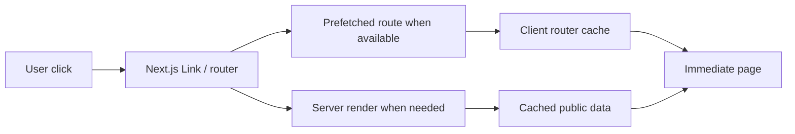

# Performance Optimization — Current System

This document records the performance architecture currently implemented in The Social Scene.

## Performance Goal

The product goal is fast perceived navigation, with a target of **under 200 ms where cached/prefetched client navigation makes that possible**. This is a performance target, not a guarantee for every uncached request or third-party API call.

## Current Request Path



## Implemented Optimizations

### 1. Next.js client navigation

Use `Link`/App Router navigation instead of full-page browser reloads for internal routes.

### 2. Router stale times

`frontend/next.config.ts` uses Next.js experimental `staleTimes` to retain suitable client router segments and reduce repeated server work during navigation.

### 3. Idle route prefetching

`NavigationPrefetch` prefetches primary routes during browser idle time. It is deliberately delayed/idle-triggered so prefetching does not compete with initial critical rendering.

### 4. Public data caching

Public event and category queries use Next.js `unstable_cache` with revalidation windows appropriate to the data.

Examples:

- Public event listings: short revalidation.
- Public event detail: short revalidation.
- Categories: longer revalidation.

### 5. Public HTTP caching

Suitable public pages use `Cache-Control` policies with `s-maxage` and `stale-while-revalidate` so Vercel/CDN can serve repeat requests without regenerating every response.

Authenticated/private endpoints are not treated as public-cacheable content.

### 6. Image optimization

Event cards use Next.js `<Image>` with responsive sizing. This reduces unnecessary image transfer and helps maintain layout stability.

### 7. Package optimization

`lucide-react` is included in Next.js `optimizePackageImports` to reduce unnecessary client bundle work.

### 8. Database indexes

Search/event-related indexes have been added in Supabase PostgreSQL. Direct database query testing showed search execution in the millisecond/sub-millisecond range for the tested paths.

Therefore, a several-hundred-millisecond or multi-second user-facing API request should not automatically be attributed to the SQL query itself; application runtime, network and provider calls must also be measured.

## Authentication Performance

The public login flow previously suffered from a race:

```text
Firebase login
   ↓
Navbar /api/profile probe
   ↓
Server session cookie not ready
   ↓
401
```

The current design establishes the server session through `/api/auth/session` and returns the profile in the same response. The Navbar reacts to Firebase auth state and refreshes server profile state after session establishment.

This removes the need for an immediate retry loop and avoids the user-facing “session is still being established” failure mode.

## Profile Request Optimization

A small client-side request cache/deduplication layer exists for profile reads to prevent duplicate concurrent profile requests. It must not cache unauthorized responses as successful authenticated state.

Profile caches are invalidated when profile updates are signaled.

## Search Performance

The search route has server-side caching and CDN cache headers where safe. Database indexes were added for event/tag mapping paths.

The correct diagnostic order for slow search is:

1. Browser request timing.
2. Vercel/server function duration.
3. Application processing.
4. Supabase query duration.
5. Third-party calls.
6. Response transfer time.

## Loading UX

`frontend/app/loading.tsx` provides immediate route-level skeleton UI. This improves perceived responsiveness even when a fresh server render cannot complete in 200 ms.

## Region Configuration

The frontend Vercel configuration uses Mumbai (`bom1`) as the primary function region and `iad1` as failover. This reduces geographic distance for the primary India audience while retaining a fallback execution region.

## What Not To Do

- Do not make every route `force-dynamic` without a data requirement.
- Do not add Edge runtime solely because a request feels slow; measure first.
- Do not make every API response publicly cacheable.
- Do not cache authenticated responses across users.
- Do not preload every route and overwhelm the initial network.
- Do not add large client libraries for simple UI behavior.
- Do not treat GA4 or browser timing as a database performance measurement.

## Measurement Method

Use browser DevTools, Vercel function timing and direct database timing separately. Record:

```text
TTFB
Server duration
DB duration
Third-party duration
Payload size
Client render/hydration time
Client navigation duration
```

## Current Bottleneck Interpretation

For the recent navigation investigation, database search execution was not the dominant latency source. The main focus is therefore server-render/cache behavior, route prefetching, authentication request sequencing, payloads and third-party dependencies.

## Visual Documentation

Mermaid diagrams are preferred for performance architecture. Add current waterfall screenshots under `docs/images/performance/` when they are available and verified against the current deployment.
