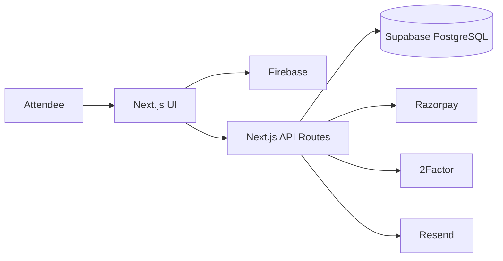
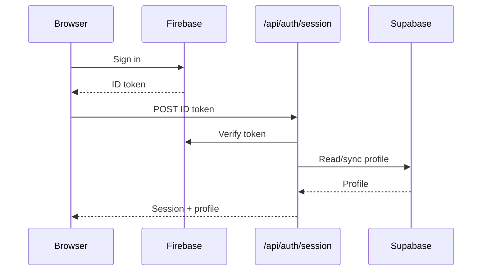
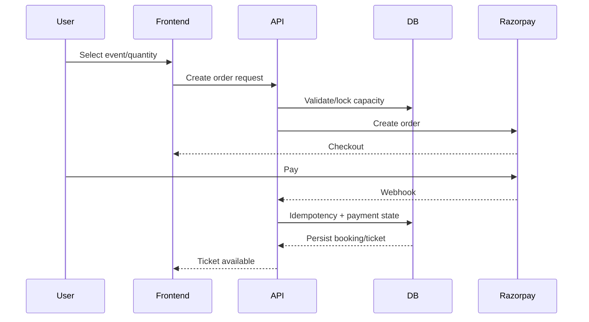

# The Social Scene — Frontend

The `frontend/` application is the public attendee-facing Next.js application for The Social Scene.

**Production:** `https://www.thesocialscene.club`  
**Local:** `http://localhost:3000`

## Current Stack

- Next.js `16.3.2` App Router.
- React `19.2.8`.
- TypeScript.
- Tailwind CSS v4.
- Firebase Client/Admin SDKs for public authentication/session integration.
- Supabase SSR/admin data access for the relational application layer.
- Razorpay for checkout/payment.
- Resend for transactional/admin email flows.
- 2Factor for phone OTP verification.
- Framer Motion for selected UI motion.
- Lucide React for icons.

## Application Model



## Public Experience

Current primary routes include:

| Route | Responsibility |
|---|---|
| `/` | Homepage/discovery |
| `/events` | Published event directory |
| `/events/[slug]` | Event details and booking entry |
| `/categories` | Category discovery |
| `/categories/[slug]` | Category-specific events |
| `/venues` | Venue discovery |
| `/hosts` | Host/community discovery where available |
| `/checkout` | Booking/payment flow |
| `/become-a-host` | Host application |
| `/login` | Authentication |
| `/onboarding` | Profile completion |
| `/account/profile` | Profile management |
| `/account/tickets` | Ticket wallet |

## Authentication

Public authentication is Firebase-based. Phone authentication uses 2Factor for OTP verification. Firebase identity is connected to the application's PostgreSQL `profiles` record.

The server session flow is deliberately atomic from the frontend perspective:



The Navbar listens to Firebase `onAuthStateChanged` and loads server profile state after authentication initialization. A `tss:auth-session-established` event is used to refresh the profile after successful server-session creation.

## Event Data & Performance

Public event/category data is cached using Next.js server caching. Public pages use revalidation and appropriate HTTP cache headers where configured.

The event library contains cached public queries such as:

- Published event lists.
- Event detail by slug.
- Public categories.
- Category event collections.

The event detail page should use the cached public event helper rather than introducing a fresh cookie-dependent query for public event data.

## Navigation Performance

Current optimizations include:

- App Router client navigation.
- Idle prefetching of primary routes.
- Client router stale times.
- Immediate route loading UI.
- Public page/data caching.
- Optimized event images through Next.js `<Image>`.
- Package import optimization for icon dependencies.

The target is fast perceived navigation, especially for prefetched routes. A universal <200 ms server response is not guaranteed because uncached requests and external services have variable latency.

## Booking & Payments



Payment confirmation must come from server-side verification/webhook processing, not merely from the browser payment callback.

## Host Applications

The `/become-a-host` form posts to `/api/host-applications`.

The API persists the application first, then awaits Resend notification delivery/acceptance. Current administrative notification destination is `support@thesocialscene.club` and the sender is `The Social Scene <noreply@thesocialscene.club>`.

If the database insert succeeds but Resend fails, the API returns a warning rather than falsely reporting complete notification success.

## Ticket Wallet

Tickets are generated after successful payment processing and are accessible from the attendee account/ticket routes. QR/barcode data is intended for dashboard scanner validation.

## Important Client-Side Rules

- Do not put service-role secrets in client code.
- Do not trust client payment success as final booking confirmation.
- Do not make authentication-dependent API calls before the server session exists.
- Use accessible labels/alt text for controls and imagery.
- Keep global Navbar behavior unchanged when modifying individual routes.
- Avoid unnecessary client components on public pages.

## Development

```bash
cd frontend
npm install
npm run dev
```

Production build:

```bash
npm run build
npm run start
```

Copy `.env.example` to `.env.local` and populate the required environment variables. Never commit real secrets.

## Visual Documentation

Use Mermaid for flows and architecture. For current UI screenshots, add images under `../docs/images/` and reference them with relative paths, for example:

```md

```

Screenshots must be refreshed whenever they no longer represent the implemented UI.
