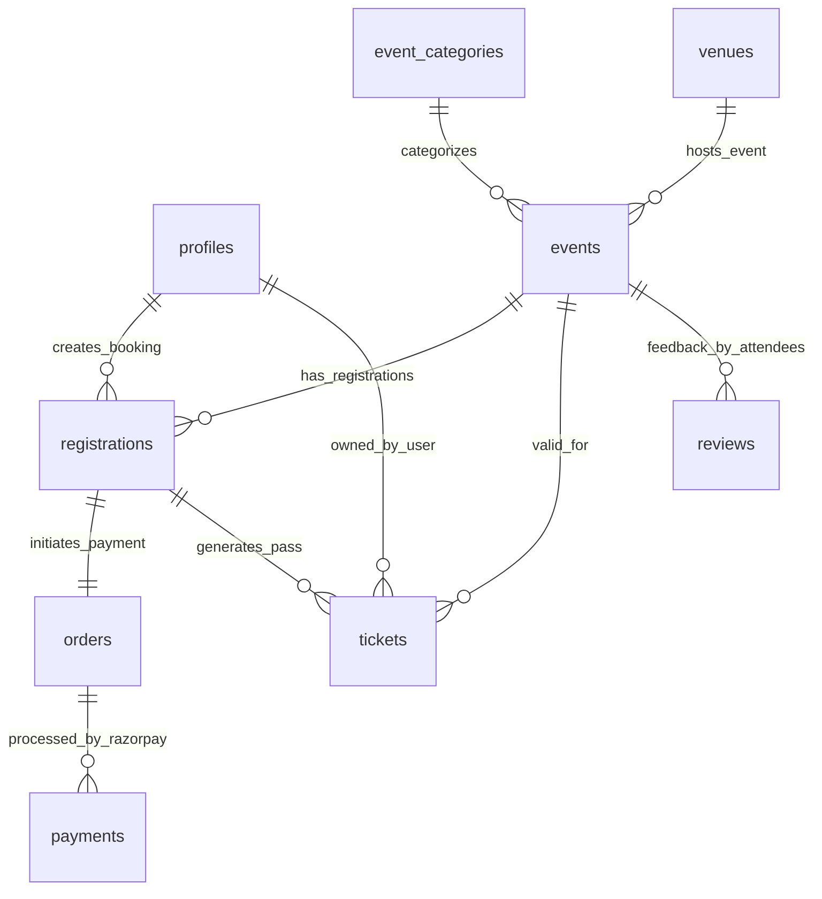

# The Social Scene — Frontend Application

Public event discovery and audience web platform for **The Social Scene** (`https://thesocialscene.club`).

[](https://nextjs.org/)
[](https://firebase.google.com/)
[](https://razorpay.com/)
[](https://framer.com/motion)

---

## 🌟 Key Features Implemented

- **GoFlow Public Discovery UI:** Animated marquee tickers, vibe filter pills, hero search bar, attendee avatar stacks, and interactive community quote walls built with Framer Motion.
- **Firebase & 2Factor Phone Auth:** Seamless mobile number login with 6-digit SMS OTP verification, profile creation, and session cookie synchronization.
- **Razorpay Payment Checkout:** Embedded Razorpay payment gateway modal supporting UPI, Cards, NetBanking, server-side signature validation, and webhook idempotency.
- **Digital Ticket Pass:** Tear-notch physical ticket stub aesthetics, barcode visualization, dynamic QR code generation, and ticket code display.
- **Host Application Form:** Dedicated `/become-a-host` portal allowing community creators to submit application proposals with social links and event concepts.
- **Google Analytics Integration:** GA4 telemetry tracking component (`G-V3MYL05JWV`) for pageview and event interaction monitoring.

---

## 🏗️ Application Routes

```text
frontend/app/
├── (public)/
│   ├── page.tsx                  # Home discovery experience with marquee & vibe filters
│   ├── events/                   # Browse events directory & detail pages ([slug])
│   ├── categories/               # Filter events by category ([slug])
│   ├── venues/                   # Explore venue details & upcoming schedules
│   ├── hosts/                    # Host profiles & curated events
│   ├── checkout/                 # Checkout flow with Razorpay payment modal
│   └── become-a-host/            # Community host application proposal form
│
├── (auth)/
│   ├── login/                    # Mobile phone & email sign-in options
│   ├── verify-otp/               # SMS OTP verification input
│   ├── verify-email/             # Magic email verification handler
│   └── onboarding/               # Profile completion flow for new members
│
└── (account)/
    ├── profile/                  # Member profile editor & phone verification status
    └── tickets/                  # Digital pass wallet & individual ticket stub view
```

---

## 📊 Public Discovery & Booking ER Diagram



> 📖 **Full Database Specification:** See [`docs/database-er-diagram.md`](file:///d:/Freelance/Project-12%20%28TheSocialScene/docs/database-er-diagram.md) for complete database specifications.

---

## ⚡ Local Development Setup

```bash
# Install dependencies
npm install

# Configure environment credentials
copy .env.example .env.local

# Run development server on port 3000
npm run dev
# Open http://localhost:3000
```
