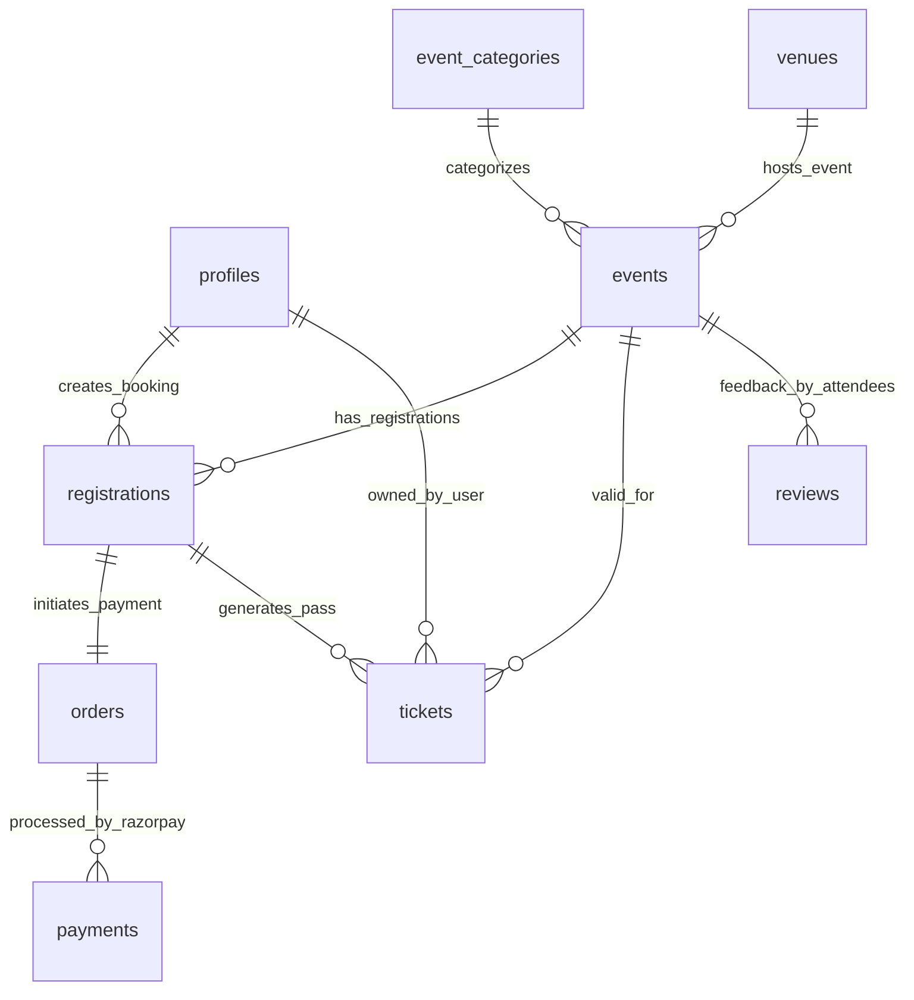

# 🌐 The Social Scene — Frontend Application

The public-facing audience web platform for **The Social Scene**, accessible in production at `https://thesocialscene.club` (or `http://localhost:3000` during local development).

[](https://nextjs.org/)
[](https://react.dev/)
[](https://firebase.google.com/)
[](https://razorpay.com/)
[](https://framer.com/motion)

---

## 📖 Table of Contents
1. [Application Purpose](#-application-purpose)
2. [Key Audience Features](#-key-audience-features)
3. [User Authentication & Phone OTP](#-user-authentication--phone-otp)
4. [Checkout & Razorpay Payment Integration](#-checkout--razorpay-payment-integration)
5. [Frontend Directory & Route Map](#-frontend-directory--route-map)
6. [Database ER Diagram Overview](#-database-er-diagram-overview)
7. [Setup & Execution Guide](#-setup--execution-guide)

---

## 🎯 Application Purpose

The Frontend web application provides an engaging experience for social event discovery and ticket purchasing. It allows attendees to:
- Discover upcoming social gatherings filtered by vibe, city, date, and category.
- Authenticate quickly using their mobile phone number via SMS OTP.
- Securely purchase event passes through Razorpay.
- Access digital ticket stubs featuring tear-notch aesthetics, barcodes, and scannable QR payloads.
- Submit proposals to become a event host (`/become-a-host`).

---

## 🚀 Key Audience Features

### 1. 🎨 GoFlow Discovery Interface (`/`)
- Dynamic ticker marquee displaying live upcoming events.
- Interactive vibe pill filters (e.g. *Mixer, Party, Workshop, Networking*).
- Hero search experience with date and venue location filters.
- Attendee avatar stacks displaying social proof and participant interest.

### 2. 📱 Firebase Phone SMS OTP Authentication (`/login`)
- 6-digit SMS OTP verification powered by **2Factor API**.
- Automatic identity creation and profile synchronization with Supabase PostgreSQL.
- Session cookie handling via Firebase Client & Admin SDKs.

### 3. 💳 Embedded Razorpay Payment Checkout (`/checkout`)
- Real-time event capacity validation before payment modal launch.
- Supports UPI (Google Pay, PhonePe, Paytm), Credit/Debit Cards, and NetBanking.
- Server-side signature verification ensuring transaction integrity.

### 4. 🎟️ Digital Ticket Wallet & Stub View (`/tickets/[ticketCode]`)
- Physical ticket stub design with tear notches and barcode visualization.
- High-resolution scannable QR payload renderer used at venue check-in.

---

## 📂 Frontend Directory & Route Map

```text
frontend/
├── app/
│   ├── (public)/
│   │   ├── page.tsx               # Homepage with marquee & vibe filters
│   │   ├── events/                # Browse events directory & detail views
│   │   ├── categories/            # Category-based event listings
│   │   ├── venues/                # Venue locations & capacity overview
│   │   ├── hosts/                 # Creator profiles & hosted events
│   │   ├── checkout/              # Booking summary & Razorpay payment handler
│   │   └── become-a-host/         # Community host proposal submission form
│   │
│   ├── (auth)/
│   │   ├── login/                 # Mobile phone sign-in page
│   │   ├── verify-otp/            # 6-digit SMS OTP input form
│   │   └── onboarding/            # Profile completion for new members
│   │
│   └── (account)/
│       ├── profile/               # Member profile editor
│       └── tickets/               # Attendee pass wallet & stub viewer
│
├── components/
│   ├── account/ProfileEditor.tsx  # User profile editor form
│   ├── analytics/GoogleAnalytics.tsx # GA4 telemetry tracking component
│   └── event/EventCard.tsx        # Event display card component
│
└── lib/
    ├── firebase/                  # Firebase Client & Admin SDK initializers
    └── supabase/                  # Supabase browser & server clients
```

---

## 📊 Database ER Diagram Overview

Below is the database relationship diagram for tables accessed by the Frontend application:



> 📖 **Field-Level Specifications:** See [`docs/database-er-diagram.md`](file:///d:/Freelance/Project-12%20%28TheSocialScene/docs/database-er-diagram.md) for full schema details.

---

## ⚡ Setup & Execution Guide

### 1. Install Dependencies
```bash
cd frontend
npm install
```

### 2. Configure Environment Variables
Copy `.env.example` to `.env.local`:
```bash
copy .env.example .env.local
```

### 3. Run Development Server
```bash
# Runs frontend on port 3000
npm run dev
```
Open `http://localhost:3000` in your browser.
